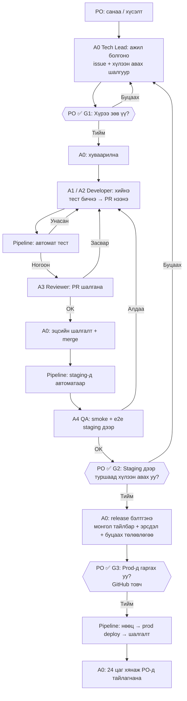

# Агентын баг ба ажлын урсгал

> **Хэнд:** Product Owner (PO) — хөгжүүлэгч биш, кодыг уншихгүй. PO **юу хийлгэхээ** шийдэж, **үр дүнг** хүлээн авна; **хэрхэн** хийхийг баг хариуцна.
> **Төлөв:** Active — PO 2026-11-11-нд баталсан (баг, merge = Tech Lead, Issues + Projects, Copilot review, 1 долоо хоногийн iteration). **v0.2.5-аас мөрдөнө.** Ерөнхий онол → [[09_Team_Handbook]]. Энэ файл = **ажиллах заавар**.

## 1. Баг — 5 агент + автомат pipeline

| # | Үүрэг | Хэрэгсэл | Юу хийнэ | Хэнд тайлагнана |
|---|---|---|---|---|
| **A0** | **Tech Lead** (багийн ахлагч) | Claude — claude.ai-ийн «S Project» Project чат | Санааг ажил болгох, техникийн шийдвэр (ADR), ажлыг агентуудад хуваарилах, эцсийн review, merge, release бэлтгэх, **PO-д монголоор тайлагнах** | PO |
| **A1** | **Developer 1** — цөм, backend, DB | Claude Code (VS Code) | Хүнд/эрсдэлтэй ажил: цөм, migration, эрх, нэвтрэлт, интеграци | Tech Lead |
| **A2** | **Developer 2** — модуль, UI | Cursor | Модулийн дэлгэц, бизнесийн урсгал, орчуулга | Tech Lead |
| **A3** | **Reviewer** | GitHub Copilot (PR review) + зохиогчоос өөр агент | PR бүрийг шалгаж comment: алдаа, аюулгүй байдал, дүрэм | Tech Lead |
| **A4** | **QA + туслах** | Devin (үнэгүй) | E2E тест, staging-ийн smoke, баримт, жижиг засвар (chore) | Tech Lead |
| — | **Pipeline** (агент биш) | GitHub Actions + Render + Vercel | Тест, staging-д deploy, нөөц, prod deploy (PO-ийн товчоор) | Tech Lead, PO (алдаа гарвал имэйл) |

**Дүрэм:**
- Зэрэг хамгийн ихдээ **2 Developer** (A1, A2) — Tech Lead болон PO хянаж амжих хэмжээ.
- **Бичсэн агент өөрийн ажлыг батлахгүй.** A1-ийн PR-ийг A2/A3, A2-ийн PR-ийг A1/A3 шалгана.
- **Claude-ийн лимит дуусвал:** A0 түр зогсоно → A2/A4 зөвхөн **аль хэдийн Ready** болсон ажлыг үргэлжлүүлнэ; merge, release, шинэ ажил эхлүүлэхгүй — A0 буцаж ирэхийг хүлээнэ.
- Ажил хоорондын дамжуулалт **зөвхөн GitHub Issue ба PR-ээр** — чатаас чат руу хуулахгүй.

## 2. Ажлын урсгал (нэг ажил)



| Алхам | Хэн | Дараагийнх руу юу дамжуулна | Хаана |
|---|---|---|---|
| 1. Санаа | PO | Энгийн үгээр: «… хийдэг болмоор байна» | Энэ чат |
| 2. Ажил болгох | A0 | Issue: зорилго, **хүлээн авах шалгуур (энгийн үгээр)**, хүрээнд орохгүй зүйл, хэмжээ | GitHub Issue |
| 3. **G1** | **PO** | ✅ / засвар | Энэ чат (A0 асууна) |
| 4. Хуваарилах | A0 | Агентын даалгаврын бэлэн текст (§4) | Issue comment |
| 5. Хийх | A1/A2 | PR: юу хийсэн, хэрхэн шалгасан, дэлгэцийн зураг | GitHub PR |
| 6. Автомат тест | Pipeline | ✅/❌ | PR |
| 7. Review | A3 | Comment-ууд, «approve» | PR |
| 8. Merge | A0 | — | `main` |
| 9. Staging | Pipeline → A4 | Smoke/e2e үр дүн | Issue comment |
| 10. **G2** | **PO** | Staging дээр туршилтын жагсаалтаар (≤10 алхам, энгийн үгээр) → ✅ / «X ажиллахгүй байна» | Энэ чат |
| 11. Release | A0 | Release тайлбар (монголоор): юу өөрчлөгдсөн, эрсдэл, буцаах арга | Энэ чат + GitHub |
| 12. **G3** | **PO** | GitHub **Actions → «Deploy production» → Run workflow** (tag сонгоно; утаснаас болно) | GitHub |
| 13. Хяналт | A0 | 24 цагийн дараа «асуудалгүй» эсвэл осол | Энэ чат |

## 3. PO-ийн хяналт ба батламж

### 3.1 PO-ийн 3 үндсэн хаалга (gate)
| Хаалга | Хэзээ | PO юуг харна | PO юуг харахгүй | Хугацаа |
|---|---|---|---|---|
| **G1 — Хүрээ** | Ажил эхлэхээс өмнө | «Энэ бол миний хүссэн зүйл мөн үү?» — зорилго, хүлээн авах шалгуур | Техникийн шийдэл | 2–5 мин / ажил |
| **G2 — Хүлээн авах** | Staging-д орсны дараа | Систем дээр өөрөө товшиж туршина (A0-ийн өгсөн жагсаалтаар) | Код, тест | 10–20 мин / release |
| **G3 — Гаргах** | Release бүр | Release тайлбар, эрсдэл → товч дарна | Техникийн дэлгэрэнгүй | 2 мин |

### 3.2 Үргэлж PO-оос асуух (онцгой)
- Өгөгдөл устгах, бодит өгөгдлийг өөрчлөх
- Хувийн мэдээлэлтэй (PII) холбоотой шинэ зүйл
- **Мөнгө** шаардах зүйл (төлбөртэй үйлчилгээ, багц ахиулах)
- Бизнесийн дүрэм баримтад байхгүй / зөрж байвал
- Аюулгүй байдлын үл хамаарал

### 3.3 PO хийхгүй
Код унших · PR батлах · команд ажиллуулах · merge conflict · техникийн сонголт (A0 санал + шалтгааныг нэг өгүүлбэрээр хэлээд шийднэ).

### 3.4 PO-ийн өдрийн хэмнэл (~20 мин)
| Хэзээ | Юу |
|---|---|
| Өглөө | A0-ийн **өдрийн тайлан** унших (≤10 мөр: дууссан, явж буй, саад, **PO-оос хэрэгтэй шийдвэр** — сонголттой асуулт) |
| Өдөрт | G1 / G2 / G3 хүлээгдэж буй бол |
| Даваа | Долоо хоногийн төлөвлөгөө (A0 санал → PO ✅) |
| Баасан | Demo (staging) + 3 мөрийн retro |

## 4. Агентад даалгавар өгөх стандарт текст

A0 issue бүрт доорхыг бэлдэнэ; PO зөвхөн хуулж тухайн агентын цонхонд тавина (эсвэл A0 өөрөө хуваарилна):

```
Чи S Project-ийн Developer (<A1|A2>). Issue #<N>-ийг хий.
1. AGENTS.md, docs/CONTEXT.md, issue #<N>-ийг унш.
2. git worktree add ..\s-project-<N> -b feat/<N>-<товч> (main-аас).
3. Хүлээн авах шалгуур бүрийг хангаж, тест бичиж, CI-г local-д ногоон болго.
4. PR нээ: template бөглө, "Closes #<N>".
5. Merge, tag, deploy ХИЙХГҮЙ. Асуулт гарвал issue-д comment бичээд зогс.
6. Issue-д 3 мөрөөр тайлагна: юу хийсэн / тест / үлдсэн.
```

Reviewer (A3):
```
Чи S Project-ийн Reviewer. PR #<M>-ийг AGENTS.md §2, §5-ын дагуу шалга:
алдаа, tenant/эрх, PII, тест хангалттай эсэх, орчуулга. Засвар шаардлагатай бол
comment; бүгд зөв бол "Approve" + 2 мөрийн дүгнэлт. Код өөрөө засахгүй.
```

## 5. Саад гарвал (escalation)
1. Developer → issue-д **«blocked: …»** гэж бичээд өөр ажил руу.
2. A0 өдөрт нэг удаа шалгаж: техникийн бол өөрөө шийднэ; бизнесийн бол PO-д **сонголттой асуулт** (A/B/C + санал).
3. Prod-ийн осол → A0 шууд PO-д: юу болсон, нөлөө, авч буй арга хэмжээ ([[09_Team_Handbook]] §10).

## 6. v0.2.5-д энэ урсгалыг босгох
- [ ] GitHub: Issues + Projects (Ready / In progress / Review / Staging / Done), label, PR template, `main`-ийн local `pre-push` hook, «Deploy production» workflow (PO гараар — GitHub Free + private repo-д branch protection, environment-ийн required reviewer байхгүй (2026-11-11 шалгав)), Sentry, Copilot code review
- [x] `AGENTS.md`-д энэ файлын §1, §3, §4-ийг товч (§0, §4 — 2026-11-11)
- [ ] Эхний ажлууд (v0.2.5-ын H1–H7)-ыг issue болгож A1/A2/A4-т хуваарилах — урсгалын эхний туршилт
