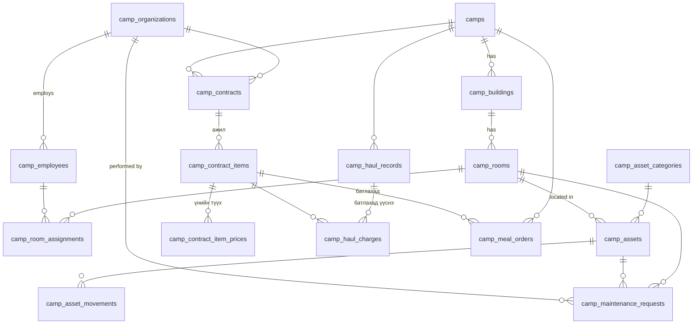

# Кемп удирдлагын модуль (Camp Module) — Төлөвлөгөө ба ERD

> 2026-10-09 · Төлөв: **ERD батлуулах шатанд** · Хувилбар: БҮРЭН (production)
> Мөрдөх: [[00_rules_and_context]] (RULE-01~20), [[03_Module_Template]],
> lessons_learned [RLS-004] (PERMISSIVE TO app_user + FORCE + GRANT), [MIG-001] (`prisma db push` ХОРИОТОЙ — зөвхөн supabase migration)

## 1. Бизнесийн шаардлага (батлагдсан)

| # | Шийдвэр |
|---|---|
| Хэрэглэгч | Уурхайн **кемп менежер** (батална) + **катерингийн админ** (бүртгэл үүсгэнэ, мастер өгөгдөл) |
| Үнэ | Үнийн цорын ганц эх сурвалж = **гэрээ**. Гэрээ бүр өөрийн хэмжих нэгжтэй (рейс / м³ / тн / хүн-өдөр) |
| Тогтмол төлбөр | Байхгүй — зөвхөн хэмжээ × нэгжийн үнэ |
| Хоол | Өдрийн нийт захиалсан хоол (өглөө+өдөр+орой) ÷ 3 = хүн-өдөр; × гэрээний хүн-өдрийн үнэ |
| Хоолны суурь тоо | Тухайн өдөр байрлаж буй ажилтны тоо (автомат) + нэмэлт тоо (гараар) |
| Бохир ус / хог | Катеринг үүсгэнэ → кемп менежер батална. Зөвхөн APPROVED нь зардалд орно |
| Хувилбар | Бүрэн (production) |

## 2. ERD

### 2.1 Хүснэгтүүд (бүгд `id UUID uuid_generate_v7()`, `tenant_id`, `created_at`, `updated_at`, RLS)

**Мастер өгөгдөл**
- `camps` — code, name, location, is_active · UNIQUE(tenant, code)
- `camp_buildings` — camp_id, code, name · UNIQUE(camp, code)
- `camp_rooms` — camp_id, building_id, room_no, floor, capacity (>0), status `ACTIVE|MAINTENANCE|INACTIVE` · UNIQUE(building, room_no)
  - "Дүүрсэн/сул" нь хадгалагдахгүй — оршин суугчдаас тооцоолно
- `camp_organizations` — name, reg_number, org_type `MAIN|SUBCONTRACTOR|CONTRACTOR`, contact_name, phone, email, is_active · UNIQUE(tenant, reg_number)
  - `vendors` (MR-ийн хөнгөн модуль)-оос тусдаа — кемпийн домэйн өөр
- `camp_employees` — organization_id, employee_code, full_name, position, phone, status `ACTIVE|INACTIVE` · UNIQUE(tenant, employee_code)

**Өрөө бүртгэл**
- `camp_room_assignments` — room_id, employee_id, check_in (date), check_out (date, null = байрлаж байгаа), note
  - DB: `EXCLUDE USING gist (employee_id WITH =, daterange(check_in, check_out) WITH &&)` — нэг ажилтан давхар өрөөнд байхгүй
  - Багтаамж: service-д өрөөг `FOR UPDATE` түгжиж шалгана
  - Өдрийн байрлагч: `check_in <= D AND (check_out IS NULL OR check_out > D)`

**Үндсэн хөрөнгө**
- `camp_asset_categories` — name (Цагаан хэрэглэл, Хөнжил ...)
- `camp_assets` — category_id, inventory_no, name, serial_no, room_id (null = агуулахад), condition `GOOD|DAMAGED|WRITTEN_OFF`, acquired_date, acquired_cost · UNIQUE(tenant, inventory_no)
- `camp_asset_movements` — asset_id, from_room_id, to_room_id, moved_at, moved_by (core_users.id, RULE-13), reason

**Засвар үйлчилгээ**
- `camp_maintenance_requests` — request_no, room_id?, asset_id? (CHECK: аль нэг нь заавал), title, description, priority `LOW|MEDIUM|HIGH|URGENT`, status `OPEN|IN_PROGRESS|DONE|CLOSED|CANCELLED`, contractor_org_id?, reported_by, assigned_at, completed_at
  - Өрөөтэй хүсэлт `IN_PROGRESS` болоход өрөө `MAINTENANCE`, бүх хүсэлт хаагдахад `ACTIVE` (нэг transaction)

**Гэрээ**
- `camp_contracts` — organization_id, camp_id, contract_no, title, start_date, end_date, status `DRAFT|ACTIVE|TERMINATED`, terminated_at, note · UNIQUE(tenant, contract_no)
  - "Хугацаа дууссан" нь хадгалахгүй — `end_date < today`-оор тооцоолно (cron хэрэггүй)
- `camp_contract_items` (гэрээгээр хийх ажил) — contract_id, service_type, unit, description
  - `service_type` enum: `SEWAGE_TRANSPORT | SEWAGE_TREATMENT | WASTE_TRANSPORT | WASTE_DISPOSAL | MEAL | MAINTENANCE`
  - `unit` enum: `TRIP | M3 | TON | PERSON_DAY | JOB`
  - UNIQUE(contract, service_type)
- `camp_contract_item_prices` — contract_item_id, effective_from (date), unit_price NUMERIC(18,2) (>=0), vat_included bool · UNIQUE(item, effective_from)
  - Тухайн өдрийн үнэ = `effective_from <= D`-ийн хамгийн сүүлийнх
- Давхардлын дүрэм: нэг кемп + нэг service_type + нэг өдөрт **нэг л** ACTIVE гэрээ (service-д `pg_advisory_xact_lock(tenant, camp, service_type)`-аар шалгана)

**Бохир ус / хог (нэгдсэн хүснэгт)**
- `camp_haul_records` — record_no, camp_id, haul_type `SEWAGE|WASTE`, haul_date, vehicle_no, driver_name, trips (>0), volume NUMERIC(15,3), volume_unit `M3|TON`, note,
  status `DRAFT|SUBMITTED|APPROVED|REJECTED`, created_by, submitted_at, approved_by, approved_at, reject_reason
  - REJECTED → засаад дахин SUBMITTED болгох боломжтой
  - DB trigger: APPROVED мөрийг UPDATE/DELETE хийхийг хориглоно
- `camp_haul_charges` — **батлах үед** үүсэх үнийн snapshot: haul_record_id, service_type, contract_item_id, organization_id, quantity, unit, unit_price, amount
  - SEWAGE → `SEWAGE_TRANSPORT` + `SEWAGE_TREATMENT` (2 мөр, өөр байгууллага байж болно)
  - WASTE → `WASTE_TRANSPORT` + `WASTE_DISPOSAL`
  - quantity: гэрээний unit TRIP бол trips, M3/TON бол volume (нэгж таарахгүй бол батлахыг 400-аар татгалзана)
  - Идэвхтэй гэрээ олдохгүй бол батлахыг татгалзана (менежерт тодорхой мессеж)

**Хоолны захиалга**
- `camp_meal_orders` — camp_id, order_date, base_count (үүсгэх үеийн snapshot), breakfast_extra, lunch_extra, dinner_extra, extra_note,
  status `DRAFT|SUBMITTED|APPROVED|REJECTED` (*асуулт A*), approved_by, approved_at,
  батлах үеийн snapshot: contract_item_id, organization_id, unit_price, person_days NUMERIC(12,4), amount · UNIQUE(tenant, camp, order_date)
  - Хоол бүрийн тоо = base_count + extra; person_days = (өглөө+өдөр+орой) / 3; amount = round(person_days × unit_price, 2)

### 2.2 Эрх (UserRole enum-д нэмнэ)
| Үйлдэл | CATERING_ADMIN | CAMP_MANAGER | OWNER/ADMIN |
|---|---|---|---|
| Мастер өгөгдөл, гэрээ, үнэ | ✅ | 👁 | ✅ |
| Өрөө, хөрөнгө, засвар | ✅ | ✅ (засвар хүсэлт) | ✅ |
| Бохир ус/хог үүсгэх, илгээх | ✅ | ❌ | ✅ |
| Бохир ус/хог батлах/татгалзах | ❌ | ✅ | ❌ |
| Хоолны захиалга | ✅ | ✅ батлах (*A*) | ✅ |
| Зардлын тайлан | ✅ | ✅ | ✅ |

> `ALTER TYPE "UserRole" ADD VALUE` нь шинэ утгыг тухайн transaction-д ашиглаж болохгүй → **тусдаа migration файл** (001), бусад нь дараагийн файлд.

## 3. Хийх ажлын төлөвлөгөө

### Шат 0 — Дизайн
- [x] 0.1 Шаардлага тодруулах (2026-10-09)
- [ ] 0.2 ERD батлуулах ← **ОДОО**
- [ ] 0.3 Үлдсэн асуулт A–D-д хариу авах

### Шат 1 — Database (supabase migrations)
- [ ] 1.1 `..001_camp_roles.sql` — UserRole + `camp_manager`, `catering_admin`
- [ ] 1.2 `..002_camp_master.sql` — camps, buildings, rooms, organizations, employees
- [ ] 1.3 `..003_camp_rooms_assets.sql` — room_assignments (btree_gist EXCLUDE), asset_*, maintenance
- [ ] 1.4 `..004_camp_contracts.sql` — contracts, items, prices (+ enum-ууд)
- [ ] 1.5 `..005_camp_operations.sql` — haul_records, haul_charges, meal_orders, APPROVED-хамгаалах trigger
- [ ] 1.6 Бүх хүснэгтэд RLS (PERMISSIVE TO app_user + FORCE + GRANT) [RLS-004]
- [ ] 1.7 `supabase migration up` → `pnpm db:generate` (db push БИШ)
- [ ] 1.8 Prisma schema: `@db.Uuid` бүгд, `Decimal`, Tenant back-relation

### Шат 2 — Backend: мастер өгөгдөл + өрөө + хөрөнгө
- [ ] 2.1 `camp-master` модуль (camp/building/room/organization/employee CRUD, cursor)
- [ ] 2.2 `camp-room` — байршуулах/гаргах, багтаамж, өдрийн байрлагчийн тоо, өрөөний самбар API
- [ ] 2.3 `camp-asset` — бүртгэл, шилжүүлэг (movement log), актлах
- [ ] 2.4 `camp-maintenance` — төлөвийн машин + өрөөний статус синк
- [ ] 2.5 Unit + integration + RLS leakage тест → ногоон

### Шат 3 — Backend: гэрээ
- [ ] 3.1 `camp-contract` — гэрээ, ажил, үнийн түүх CRUD
- [ ] 3.2 `ContractPricingService.resolve(campId, serviceType, date)` → {contractItem, org, unit, unitPrice} эсвэл тодорхой алдаа
- [ ] 3.3 Давхардсан идэвхтэй гэрээ хориглох (advisory lock)
- [ ] 3.4 Дуусах дөхсөн гэрээний жагсаалт (30 хоног)
- [ ] 3.5 Тест: үнэ өөрчлөгдсөн өдөр, дууссан гэрээ, TERMINATED, давхардал → ногоон

### Шат 4 — Backend: бохир ус / хог / хоол
- [ ] 4.1 `camp-haul` — CRUD + submit/approve/reject, батлахад charges snapshot (нэг transaction)
- [ ] 4.2 `camp-meal` — base_count автомат, нэмэлт, ÷3 тооцоо, батлахад snapshot
- [ ] 4.3 Тест: эрх (катеринг батлах → 403), батлагдсаныг засах → 409/trigger, нэгж таарахгүй → 400 → ногоон

### Шат 5 — Backend: зардлын тайлан
- [ ] 5.1 `camp-cost-report` — огнооны муж × кемп: байгууллага → гэрээ → үйлчилгээ бүлэглэлт (зөвхөн snapshot-оос)
- [ ] 5.2 Анхааруулга: SUBMITTED хүлээгдэж буй бүртгэл, гэрээгүй өдрүүд
- [ ] 5.3 Байгууллага бүрээр тооцоо нийлэх акт
- [ ] 5.4 Excel экспорт
- [ ] 5.5 Тест: гараар тооцсон жишиг өгөгдөлтэй тулгах → ногоон

### Шат 6 — Frontend (web-shell)
- [ ] 6.1 Мастер өгөгдөл: кемп/байр/өрөө, байгууллага, ажилтан
- [ ] 6.2 Гэрээ: жагсаалт, ажил + үнийн түүх засах
- [ ] 6.3 Өрөөний самбар (дүүргэлт), байршуулах/гаргах
- [ ] 6.4 Хөрөнгө, засвар үйлчилгээ
- [ ] 6.5 Бохир ус/хог бүртгэл + кемп менежерийн батлах дараалал
- [ ] 6.6 Өдрийн хоолны захиалга
- [ ] 6.7 Зардлын тайлан + Excel татах
- [ ] 6.8 `tsc --noEmit` + eslint + e2e гол урсгал

### Шат 7 — Баримт
- [ ] 7.1 [[CHANGELOG]], [[00_rules_and_context]] codebase хэсэг
- [ ] 7.2 Гарсан алдааг [[lessons_learned]]-д

## 4. Нээлттэй асуултууд
- **A.** Хоолны захиалгыг кемп менежер батлах уу, эсвэл катеринг илгээмэгц зардалд орох уу?
- **B.** Ажилтан гарах өдрөө хоолны суурь тоонд тооцогдох уу? (санал: орох өдөр тооцно, гарах өдөр тооцохгүй)
- **C.** Засвар үйлчилгээний зардал тайланд орох уу? (одоогийн жагсаалтад байхгүй тул зөвхөн бүртгэл гэж төлөвлөв)
- **D.** НӨАТ-ыг тайланд тусад нь задлах уу?
