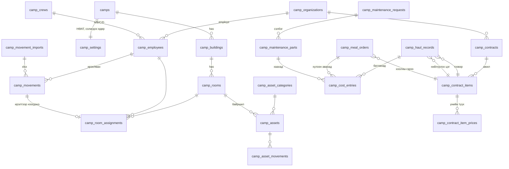

# Кемп удирдлагын модуль (Camp Module) — Төлөвлөгөө ба ERD · v2

> 2026-10-09 · Төлөв: **ERD v2 батлуулах шатанд** · Хувилбар: БҮРЭН (production) · Өмнөх: [[01_plan_and_erd.v1]]
> Мөрдөх: [[00_rules_and_context]] (RULE-01~20), [[03_Module_Template]],
> lessons_learned [RLS-004] (PERMISSIVE TO app_user + FORCE + GRANT), [MIG-001] (`prisma db push` ХОРИОТОЙ — зөвхөн supabase migration)

## 1. Бизнесийн шаардлага (батлагдсан)

| # | Шийдвэр |
|---|---|
| Хэрэглэгч / эрх | `camp_admin` (нарийн тохиргоо), `camp_manager` (уурхай — батлах, хоол захиалах), `catering_admin` (катеринг — бүртгэл, захиалга хүлээн авах) |
| Үнэ | Үнийн цорын ганц эх сурвалж = **гэрээ**. Гэрээ бүр өөрийн нэгжтэй (рейс / м³ / тн / хүн-өдөр / ширхэг) |
| Гэрээний давхардал | Нэг кемп + нэг үйлчилгээ + нэг өдөрт **олон идэвхтэй гэрээ байж болно** → бүртгэл бүр дээр гэрээг **сонгоно** |
| Тогтмол төлбөр | Байхгүй |
| НӨАТ | Тооцоолно. Үнэ НӨАТ-тай/НӨАТ-гүй эсэх гэрээний мөр бүрт; хувь хэмжээг `camp_admin` тохируулна (анхдагч 10%) |
| Хоол | 24 цагийн ажиллагаа → **4 хоол**: өглөө, өдөр, орой, шөнө |
| Хоолны төлбөр | Өдрийн нийт хоол ÷ 3 = хүн-өдөр × гэрээний үнэ (*асуулт 1 — 4 хоолтой үед ч ÷3 хэвээр үү*) |
| Хоолны урсгал | Кемп менежер өдөр бүр **маргаашийн** тоог хянаж захиална → катеринг админ хүлээн авна → **хүлээн авсны дараа** зардалд орно |
| Бохир ус / хог | Катеринг үүсгэнэ (тээврийн гэрээт + **нийлүүлэх цэг**-ийн гэрээт байгууллага сонгоно) → кемп менежер батална |
| Засвар | Ажлын хөлс үнэгүй. Сэлбэг уурхайгаас. Катеринг **өөрөө худалдаж авсан** сэлбэгийг тоо ширхэг, үнэтэй бүртгэнэ → зардалд орно |
| Өрөө | Багтаамжийг өрөө бүрээр тохируулна; сул/дүүрсэн харагдана |
| Ээлж | 4 баг, 14/14 ростер. Солигдох өдөр **Лхагва**: ирж буй баг оройн хоолноос, бууж буй баг өглөөний хоол идээд явна |
| Ээлжийн бус | Ирэх/явахдаа идэх хоолоо (өглөө/өдөр/орой/шөнө) сонгоно |
| Ирц импорт | Ээлжээр ирж/явж буй бүртгэлийг **xlsx**-ээр ажилтны ID-аар импортлоно |

## 2. ERD

### 2.1 Хүснэгтүүд (бүгд `id UUID uuid_generate_v7()`, `tenant_id`, `created_at`, `updated_at`, RLS)

**Тохиргоо ба мастер өгөгдөл** (`camp_admin`)
- `camps` — code, name, location, is_active · UNIQUE(tenant, code)
- `camp_settings` — camp_id (1:1), vat_rate NUMERIC(5,2) default 10, changeover_weekday default 3 (Лхагва), meal_order_cutoff_time (маргаашийн захиалгын эцсийн цаг), roster_on_days 14, roster_off_days 14
- `camp_buildings` — camp_id, code, name
- `camp_rooms` — camp_id, building_id, room_no, floor, **capacity** (>0), status `ACTIVE|MAINTENANCE|INACTIVE`
  - Дүүргэлт = идэвхтэй оршин суугч / capacity → `VACANT | PARTIAL | FULL` (тооцоолно, хадгалахгүй)
- `camp_organizations` — name, reg_number, org_type `MAIN|SUBCONTRACTOR|CONTRACTOR`, is_disposal_point (bool — хог/бохир нийлүүлэх цэг эсэх), contact, is_active
- `camp_crews` — camp_id, code (A/B/C/D), name, roster_anchor_date (энэ багийн ирэх нэг Лхагва — 28 хоногийн мөчлөгийн эхлэл)
- `camp_employees` — organization_id, crew_id? (ээлжгүй бол null), **employee_code** (импортын түлхүүр), full_name, position, phone, status · UNIQUE(tenant, employee_code)

**Ирц / ээлжийн бүртгэл** *(шинэ)*
- `camp_movement_imports` — file_name, uploaded_by, total_rows, ok_rows, error_rows, errors JSONB, status `PREVIEW|CONFIRMED|CANCELLED`
- `camp_movements` — employee_id, camp_id, movement_date, direction `ARRIVAL|DEPARTURE`, kind `ROSTER|OFF_ROSTER`, import_id?, meals (text[] ⊂ {BREAKFAST,LUNCH,DINNER,NIGHT}), note
  - `kind` автоматаар: огноо = багийн ростерын солигдох өдөр → `ROSTER`, үгүй бол `OFF_ROSTER`
  - Хоолны анхдагч: ROSTER ARRIVAL → `{DINNER}` ба түүнээс хойш; ROSTER DEPARTURE → `{BREAKFAST}`; OFF_ROSTER → xlsx/UI-аас сонгосон
  - UNIQUE(employee, movement_date, direction)
- **xlsx импорт урсгал:** upload → мөр бүрийг шалгаж PREVIEW (алдааг мөрийн дугаартай) → хэрэглэгч CONFIRM → нэг transaction-д бичнэ
  - Баганууд: `employee_code | date | direction (ИРСЭН/ЯВСАН) | meals (заавал биш: Ө,Ө,О,Ш)`
  - Загвар xlsx татах товч

**Өрөө**
- `camp_room_assignments` — room_id, employee_id, check_in, check_out?, arrival_movement_id?, departure_movement_id?
  - DB: `EXCLUDE USING gist (employee_id WITH =, daterange(check_in, check_out) WITH &&)`
  - Багтаамж: өрөөг `FOR UPDATE` түгжиж шалгана
  - ARRIVAL импортлогдоход өмнөх өрөөнд нь автоматаар байршуулах санал (*асуулт 2*), DEPARTURE → check_out автоматаар

**Үндсэн хөрөнгө** — `camp_asset_categories`, `camp_assets` (inventory_no, room_id?, condition), `camp_asset_movements` (v1-тэй адил)

**Засвар үйлчилгээ**
- `camp_maintenance_requests` — request_no, room_id?/asset_id?, title, description, priority, status `OPEN|IN_PROGRESS|DONE|CLOSED|CANCELLED`, reported_by, completed_at, closed_by
- `camp_maintenance_parts` *(шинэ)* — request_id, part_name, quantity, unit, unit_price, vat_included, source `MINE_SUPPLIED|CATERING_PURCHASED`
  - Зөвхөн `CATERING_PURCHASED` × кемп менежер `CLOSED` болгосон үед зардалд орно

**Гэрээ**
- `camp_contracts` — organization_id, camp_id, contract_no, title, start_date, end_date, status `DRAFT|ACTIVE|TERMINATED`
- `camp_contract_items` — contract_id, service_type, unit, description · UNIQUE(contract, service_type)
  - `service_type`: `SEWAGE_TRANSPORT | SEWAGE_DISPOSAL | WASTE_TRANSPORT | WASTE_DISPOSAL | MEAL`
  - `unit`: `TRIP | M3 | TON | PERSON_DAY`
- `camp_contract_item_prices` — contract_item_id, effective_from, unit_price, vat_included · UNIQUE(item, effective_from)
- Давхардал хориглохгүй (v1-ээс өөрчлөгдсөн). Сонгосон гэрээ тухайн огноонд ACTIVE + хугацаандаа + үнэтэй байх ёстой

**Бохир ус / хог**
- `camp_haul_records` — record_no, camp_id, haul_type `SEWAGE|WASTE`, haul_date, vehicle_no, driver_name, trips, volume, volume_unit,
  **transport_contract_item_id**, **disposal_contract_item_id** (нийлүүлэх цэг), status `DRAFT|SUBMITTED|APPROVED|REJECTED`, created_by, submitted_at, approved_by, approved_at, reject_reason
  - Сонгох жагсаалт: тухайн огноонд идэвхтэй, тохирох service_type-тай гэрээнүүд (нэг л байвал автоматаар)
  - DB trigger: APPROVED мөрийг UPDATE/DELETE хориглоно

**Хоолны захиалга**
- `camp_meal_orders` — camp_id, order_date (маргааш), meal_contract_item_id,
  тооцоолсон суурь: base_breakfast, base_lunch, base_dinner, base_night (захиалах үеийн snapshot),
  нэмэлт: extra_breakfast, extra_lunch, extra_dinner, extra_night, extra_note,
  status `DRAFT|ORDERED|ACCEPTED|REJECTED`, ordered_by (менежер), accepted_by (катеринг) · UNIQUE(tenant, camp, order_date)
- **Суурь тооцоо (хоол бүрээр):**
  - Бүтэн өдөр байгаа (ирсэн < D < явах) → *асуулт 1*-ийн хариугаар
  - D өдөр ирсэн / явсан → `camp_movements.meals`-ийн дагуу
- Хүн-өдөр = нийт хоол ÷ 3 (*асуулт 1*)

**Нэгдсэн зардлын бүртгэл** *(шинэ — тайлангийн цорын ганц эх сурвалж)*
- `camp_cost_entries` — camp_id, cost_date, source_type `HAUL|MEAL|MAINTENANCE_PART`, source_id, service_type?, organization_id?, contract_item_id?,
  quantity, unit, unit_price, **net_amount, vat_amount, gross_amount**, vat_rate
  - Батлах/хүлээн авах/хаах үед нэг transaction-д бичигдэнэ (snapshot) → гэрээ/НӨАТ дараа өөрчлөгдсөн ч хөдлөхгүй
  - НӨАТ: vat_included бол net = gross / (1+r); үгүй бол vat = net × r; бүгд 2 оронтой бутархайгаар тойм

### 2.2 Эрх
| Үйлдэл | camp_admin | camp_manager | catering_admin |
|---|---|---|---|
| Кемп тохиргоо, НӨАТ, баг/ростер, байгууллага, гэрээ, үнэ | ✅ | 👁 | 👁 |
| Ажилтан, өрөө, хөрөнгө | ✅ | 👁 | ✅ |
| Ирц xlsx импорт | ✅ | ✅ | ✅ (*асуулт 3*) |
| Бохир ус/хог үүсгэх, илгээх | ❌ | ❌ | ✅ |
| Бохир ус/хог батлах/татгалзах | ❌ | ✅ | ❌ |
| Хоол захиалах (маргааш) | ❌ | ✅ | ❌ |
| Хоолны захиалга хүлээн авах | ❌ | ❌ | ✅ |
| Засвар нээх / сэлбэг бүртгэх | ✅ | ✅ / ❌ | ✅ / ✅ |
| Засвар хаах (сэлбэгийн зардлыг батлах) | ❌ | ✅ | ❌ |
| Зардлын тайлан | ✅ | ✅ | ✅ |

> `ALTER TYPE "UserRole" ADD VALUE` нь тухайн transaction-д ашиглагдахгүй → **тусдаа migration файл**.

## 3. Хийх ажлын төлөвлөгөө

### Шат 0 — Дизайн
- [x] 0.1 Шаардлага тодруулах (2026-10-09)
- [x] 0.2a ERD v1
- [ ] 0.2b ERD v2 батлуулах ← **ОДОО**
- [ ] 0.3 Үлдсэн асуулт 1–3

### Шат 1 — Database (supabase migrations)
- [ ] 1.1 `..001_camp_roles.sql` — `camp_admin`, `camp_manager`, `catering_admin`
- [ ] 1.2 `..002_camp_master.sql` — camps, settings, buildings, rooms, organizations, crews, employees
- [ ] 1.3 `..003_camp_movements_rooms.sql` — movement_imports, movements, room_assignments (btree_gist)
- [ ] 1.4 `..004_camp_assets_maintenance.sql` — assets, maintenance, parts
- [ ] 1.5 `..005_camp_contracts.sql` — contracts, items, prices
- [ ] 1.6 `..006_camp_operations.sql` — haul_records, meal_orders, cost_entries, хамгаалах trigger-үүд
- [ ] 1.7 Бүх хүснэгтэд RLS [RLS-004] + GRANT
- [ ] 1.8 `supabase migration up` → `pnpm db:generate`; Prisma schema (`@db.Uuid`, `Decimal`, back-relation)

### Шат 2 — Backend: тохиргоо, мастер өгөгдөл
- [ ] 2.1 `camp-settings` (НӨАТ, солигдох өдөр, ростер)
- [ ] 2.2 `camp-master` (кемп/байр/өрөө/байгууллага/баг/ажилтан CRUD, cursor)
- [ ] 2.3 Тест → ногоон

### Шат 3 — Backend: ирц ба өрөө
- [ ] 3.1 `exceljs` нэмэх (core-kernel), upload (`FileInterceptor`, хэмжээ/төрөл хязгаар)
- [ ] 3.2 `RosterService` — багийн солигдох өдрийг тооцох, ROSTER/OFF_ROSTER ангилах
- [ ] 3.3 Импорт: PREVIEW (мөрийн алдаа) → CONFIRM (нэг transaction), загвар xlsx татах
- [ ] 3.4 Өрөө байршуулах/гаргах, багтаамж, өрөөний самбар (сул/дүүрсэн)
- [ ] 3.5 `PresenceService` — D өдрийн хоол бүрийн суурь тоо
- [ ] 3.6 Тест: Лхагва ирэлт → оройн хоол, явалт → өглөөний хоол, ээлжийн бус сонголт, буруу ID/огноо/давхардал → ногоон

### Шат 4 — Backend: хөрөнгө, засвар
- [ ] 4.1 `camp-asset` (бүртгэл, шилжүүлэг, актлах)
- [ ] 4.2 `camp-maintenance` (төлөв, өрөөний статус синк, сэлбэг, хаахад cost_entry)
- [ ] 4.3 Тест → ногоон

### Шат 5 — Backend: гэрээ ба зардал
- [ ] 5.1 `camp-contract` (гэрээ, ажил, үнийн түүх)
- [ ] 5.2 `ContractPricingService.priceFor(contractItemId, date)` + `listAvailable(camp, serviceType, date)`
- [ ] 5.3 `VatCalculator` (included / excluded, тойм)
- [ ] 5.4 `CostEntryWriter` — бүх эх сурвалжийн snapshot бичигч
- [ ] 5.5 Тест: үнэ өөрчлөгдсөн өдөр, дууссан/TERMINATED гэрээ, НӨАТ хоёр горим, тойм → ногоон

### Шат 6 — Backend: бохир ус / хог / хоол
- [ ] 6.1 `camp-haul` (CRUD, submit/approve/reject, гэрээ сонголт, батлахад 2 cost_entry)
- [ ] 6.2 `camp-meal` (маргаашийн суурь тооцоо, нэмэлт, ORDERED → ACCEPTED, хүлээн авахад cost_entry)
- [ ] 6.3 Тест: эрх (403), батлагдсаныг засах (409), нэгж таарахгүй (400) → ногоон

### Шат 7 — Backend: зардлын тайлан
- [ ] 7.1 `camp-cost-report` — зөвхөн `camp_cost_entries`-оос: байгууллага → гэрээ → үйлчилгээ, net/НӨАТ/нийт
- [ ] 7.2 Анхааруулга: хүлээгдэж буй (SUBMITTED/ORDERED) бүртгэл
- [ ] 7.3 Байгууллага бүрээр тооцоо нийлэх акт
- [ ] 7.4 Excel экспорт
- [ ] 7.5 Тест: гараар тооцсон жишигтэй тулгах → ногоон

### Шат 8 — Frontend (web-shell)
- [ ] 8.1 Тохиргоо (camp_admin): кемп, НӨАТ, баг/ростер, байгууллага, гэрээ + үнэ
- [ ] 8.2 Ажилтан, ирц xlsx импорт (preview + алдааны жагсаалт)
- [ ] 8.3 Өрөөний самбар (сул/дүүрсэн), байршуулалт
- [ ] 8.4 Хөрөнгө, засвар + сэлбэг
- [ ] 8.5 Бохир ус/хог бүртгэл + менежерийн батлах дараалал
- [ ] 8.6 Маргаашийн хоолны захиалга (менежер) / хүлээн авах (катеринг)
- [ ] 8.7 Зардлын тайлан + Excel
- [ ] 8.8 `tsc --noEmit` + eslint + e2e гол урсгал

### Шат 9 — Баримт
- [ ] 9.1 [[CHANGELOG]], [[00_rules_and_context]] (RULE-12-ийг [RLS-004]-тэй нийцүүлэх)
- [ ] 9.2 Алдааг [[lessons_learned]]-д

## 4. Нээлттэй асуултууд
1. **Бүтэн өдөр байгаа ажилтны хоол:** 4 хоолоос аль 3-ыг иднэ? Ажилтан өдрийн/шөнийн ээлжтэй (өдөр: өглөө-өдөр-орой; шөнө: орой-шөнө-өглөө гэх мэт) гэж тохируулах уу, эсвэл ажилтан бүрийг 3 хоол гэж тоолоод аль хоолонд хэдэн хүн гэдгийг менежер засах уу? Төлбөр 4 хоолтой үед ч **нийт ÷ 3** хэвээр үү?
2. **Өрөө:** Ээлж солигдох багууд нэг өрөөг хуваалцдаг уу (A баг явахад C баг тэр өрөөнд орох)? Ирэлт импортлогдоход өмнөх өрөөнд нь автоматаар байршуулах уу?
3. **Ирц импорт хэн хийх вэ** — катеринг, кемп менежер, аль аль нь уу? "Цагийн бүртгэл" гэдэгт ажилласан цаг (ирц/цаг) бас орох уу, эсвэл зөвхөн ээлжийн ирэх/явах бүртгэл үү?
