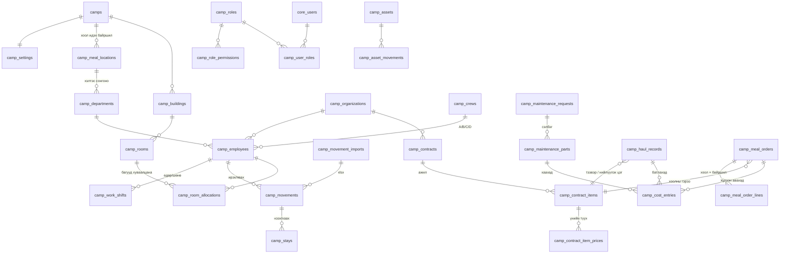

# Кемп удирдлагын модуль (Camp Module) — Төлөвлөгөө ба ERD · v3

> 2026-10-09 · Төлөв: **ERD v3 батлуулах шатанд** · Хувилбар: БҮРЭН (production) · Өмнөх: [[01_plan_and_erd.v1]], [[01_plan_and_erd.v2]]
> Мөрдөх: [[00_rules_and_context]] (RULE-01~20), [[03_Module_Template]],
> lessons_learned [RLS-004] (PERMISSIVE TO app_user + FORCE + GRANT), [MIG-001] (`prisma db push` ХОРИОТОЙ — зөвхөн supabase migration)

## 1. Бизнесийн шаардлага (батлагдсан)

| # | Шийдвэр |
|---|---|
| Эрх | **Админ бүх эрхийг тохируулна** (role → permission). Анхдагч 3 роль: Кемп админ, Кемп менежер, Катеринг админ — засах боломжтой |
| Үнэ | Үнийн цорын ганц эх сурвалж = **гэрээ**; гэрээ бүр өөрийн нэгжтэй (рейс / м³ / тн / хүн-өдөр) |
| Гэрээний давхардал | Нэг үйлчилгээнд олон идэвхтэй гэрээ байж болно → бүртгэл бүр дээр гэрээг **сонгоно** |
| НӨАТ | Тооцоолно; үнэ НӨАТ-тай/гүй эсэх гэрээний мөр бүрт; хувь хэмжээг тохиргоонд (анхдагч 10%) |
| Хоол | 4 хоол: өглөө, өдөр, орой, шөнө. Хүн өдөрт 3 хоол → нийт хоол ÷ 3 = хүн-өдөр × гэрээний үнэ |
| Өдөр/шөнийн ээлж | **Цагийн бүртгэлд** ажилтныг өдөр эсвэл шөнө гэж тохируулна |
| Хэлтэс | Хэлтэс бүр **хоол идэх байршилтай** (үүсгэх, засахдаа сонгоно/солино). Жнь: Уул засвар → Уулын хэсэг; Захиргаа, ХН → Кемп |
| Хоол идэх байршил | Тохиргоо хэсэгт үүсгэнэ |
| Хоолны урсгал | Кемп менежер маргаашийн тоог хянаж захиална → катеринг админ хүлээн авна → **хүлээн авсны дараа** зардалд орно |
| Бохир ус / хог | Катеринг үүсгэнэ (тээврийн + **нийлүүлэх цэг**-ийн гэрээт байгууллага сонгоно) → кемп менежер батална |
| Засвар | Ажлын хөлс үнэгүй; сэлбэг уурхайгаас. Катеринг **өөрөө авсан** сэлбэгийг тоо, үнэтэй бүртгэнэ → зардалд орно |
| Өрөө | Багтаамжийг өрөө бүрээр; сул/дүүрсэн харагдана. Ээлж солигдоход **багууд өрөөг хуваалцана** |
| Ростер | 4 баг, 14/14. Лхагва солигдоно: ирж буй баг оройн хоолноос, бууж буй баг өглөөний хоол идээд явна. Ээлжийн бусаар ирвэл хоолоо сонгоно |
| Ирц импорт | Кемп менежер xlsx-ээр (ажилтны кодоор) импортлоно |

## 2. ERD

### 2.1 Хүснэгтүүд (бүгд `id UUID uuid_generate_v7()`, `tenant_id`, `created_at`, `updated_at`, RLS)

**Эрхийн тохиргоо (RBAC)** *(шинэ — `UserRole` enum-ийг өөрчлөхгүй)*
- Permission каталог кодонд тогтмол (жнь `camp.settings.manage`, `camp.roles.manage`, `camp.contract.manage`, `camp.employee.manage`,
  `camp.movement.import`, `camp.workshift.manage`, `camp.room.manage`, `camp.asset.manage`, `camp.maintenance.create`,
  `camp.maintenance.parts`, `camp.maintenance.close`, `camp.haul.create`, `camp.haul.approve`, `camp.meal.order`, `camp.meal.accept`, `camp.report.view`)
- `camp_roles` — name, description, is_system (анхдагч роль: устгах боломжгүй, эрхийг нь засаж болно) · UNIQUE(tenant, name)
- `camp_role_permissions` — role_id, permission_code (CHECK: каталогт байгаа код) · PK(role, code)
- `camp_user_roles` — user_id (`core_users.id`, RULE-13), role_id, camp_id? (null = бүх кемп)
- Tenant-ийн `OWNER`/`ADMIN` (одоогийн UserRole) → кемпийн бүх эрхтэй + роль тохируулна (эхний тохиргоо хийх боломж)
- Helper `requireCampPermission(tx, tenantId, authId, campId, code)` → `core_users.id` буцаана; Redis cache, роль өөрчлөгдөхөд invalidate
- Хяналтын дүрэм: бүртгэл үүсгэсэн хүн өөрийнхөө бүртгэлийг батлахгүй

**Тохиргоо ба мастер өгөгдөл**
- `camps` — code, name, location, is_active
- `camp_settings` — camp_id (1:1), vat_rate (10), changeover_weekday (3 = Лхагва), roster_on_days (14), roster_off_days (14), meal_order_cutoff_time
- `camp_meal_locations` *(шинэ)* — camp_id, name (Кемп гал тогоо, Уулын хэсэг …), is_active · UNIQUE(camp, name)
- `camp_departments` *(шинэ)* — camp_id, code, name, **meal_location_id**, is_active · UNIQUE(camp, code)
  - Байршлыг солиход өмнөх захиалга өөрчлөгдөхгүй (захиалгын мөрөнд байршил snapshot-оор хадгалагдана)
- `camp_buildings`, `camp_rooms` (capacity > 0, status `ACTIVE|MAINTENANCE|INACTIVE`)
- `camp_organizations` — name, reg_number, org_type `MAIN|SUBCONTRACTOR|CONTRACTOR`, is_disposal_point, contact, is_active
- `camp_crews` — camp_id, code (A/B/C/D), roster_anchor_date (энэ багийн ирэх нэг Лхагва)
- `camp_employees` — organization_id, department_id, crew_id?, employee_code (импортын түлхүүр), full_name, position, phone, default_shift `DAY|NIGHT`, status

**Цагийн бүртгэл / ирц**
- `camp_work_shifts` *(шинэ)* — employee_id, start_date, end_date?, shift `DAY|NIGHT` · EXCLUDE давхцал (employee, daterange)
  - Олдохгүй бол `camp_employees.default_shift`
- `camp_movement_imports` — file_name, uploaded_by, total/ok/error_rows, errors JSONB, status `PREVIEW|CONFIRMED|CANCELLED`
- `camp_movements` — employee_id, camp_id, movement_date, direction `ARRIVAL|DEPARTURE`, kind `ROSTER|OFF_ROSTER` (автомат), meals text[], import_id? · UNIQUE(employee, date, direction)
  - ROSTER ирэлт → `{DINNER}`, ROSTER явалт → `{BREAKFAST}`, OFF_ROSTER → сонгосон хоол
- `camp_stays` *(шинэ)* — employee_id, camp_id, arrival_movement_id, departure_movement_id?, start_date, end_date? · EXCLUDE давхцал
  - Ирэлт → нээнэ, явалт → хаана. **Байгаа эсэх**-ийн цорын ганц эх сурвалж
- xlsx: `employee_code | date | ИРСЭН/ЯВСАН | хоол (заавал биш: Ө,Ө,О,Ш) | ээлж (заавал биш: ӨДӨР/ШӨНӨ)` → PREVIEW (мөрийн алдаа) → CONFIRM (нэг transaction)

**Өрөө (багууд хуваалцана)**
- `camp_room_allocations` — room_id, employee_id, start_date, end_date? — ажилтны **үндсэн өрөө** · EXCLUDE давхцал (employee)
  - Нэг өрөөнд өөр өөр багийн ажилтнууд хуваарилагдана
  - Хуваарилахад шалгалт: ростерын дагуу дараагийн 28 хоногийн аль ч өдөр **тэнд байх** хүний тоо ≤ capacity (хэтэрвэл өдрийг нэрлэж 409)
- Дүүргэлт (D өдөр) = тухайн өрөөнд хуваарилагдсан **ба** `camp_stays`-аар байгаа хүн → `VACANT | PARTIAL | FULL`
- Ээлжийн бусаар ирэхэд өрөө дүүрсэн бол "өрөөгүй" жагсаалтад орж менежер байршуулна

**Үндсэн хөрөнгө** — `camp_asset_categories`, `camp_assets`, `camp_asset_movements` (өмнөхтэй адил)

**Засвар** — `camp_maintenance_requests`, `camp_maintenance_parts` (source `MINE_SUPPLIED|CATERING_PURCHASED`; зөвхөн CATERING_PURCHASED нь CLOSED болоход зардалд)

**Гэрээ** — `camp_contracts`, `camp_contract_items` (`SEWAGE_TRANSPORT|SEWAGE_DISPOSAL|WASTE_TRANSPORT|WASTE_DISPOSAL|MEAL`; `TRIP|M3|TON|PERSON_DAY`), `camp_contract_item_prices` (effective_from, unit_price, vat_included)

**Бохир ус / хог** — `camp_haul_records` (transport_contract_item_id, disposal_contract_item_id, `DRAFT|SUBMITTED|APPROVED|REJECTED`, APPROVED-г trigger хамгаална)

**Хоолны захиалга** *(бүтэц өөрчлөгдсөн)*
- `camp_meal_orders` — camp_id, order_date, meal_contract_item_id, status `DRAFT|ORDERED|ACCEPTED|REJECTED`, ordered_by, accepted_by, note · UNIQUE(tenant, camp, order_date)
- `camp_meal_order_lines` — order_id, meal_type `BREAKFAST|LUNCH|DINNER|NIGHT`, meal_location_id, base_count (тооцоолсон snapshot), extra_count, extra_note · UNIQUE(order, meal_type, location)
- **Суурь тооцоо (D өдөр, ажилтан бүрээр):**
  | Байдал | Хоол |
  |---|---|
  | Бүтэн өдөр, **ӨДӨР** ээлж | Өглөө (кемп), **Өдөр (хэлтсийн байршил)**, Орой (кемп) |
  | Бүтэн өдөр, **ШӨНӨ** ээлж | Орой (кемп), **Шөнө (хэлтсийн байршил)**, Өглөө (кемп) |
  | D өдөр ирсэн / явсан | `camp_movements.meals`; ажлын хоол бол хэлтсийн байршил |
  *(кемп = тохиргоонд "анхдагч кемпийн байршил" — асуулт 1)*
- Хүн-өдөр = Σ(base + extra) ÷ 3

**Нэгдсэн зардал** — `camp_cost_entries` (source `HAUL|MEAL|MAINTENANCE_PART`, quantity, unit_price, net/vat/gross, vat_rate) — тайлангийн цорын ганц эх сурвалж, батлах/хүлээн авах/хаах үеийн snapshot

### 2.2 Анхдагч ролиуд (админ засна)
| Permission | Кемп админ | Кемп менежер | Катеринг админ |
|---|---|---|---|
| settings / roles / contract / master | ✅ | | |
| employee.manage, room.manage, asset.manage | ✅ | | ✅ |
| movement.import, workshift.manage | ✅ | ✅ | |
| haul.create, maintenance.parts | | | ✅ |
| haul.approve, maintenance.close, meal.order | | ✅ | |
| meal.accept | | | ✅ |
| maintenance.create, report.view | ✅ | ✅ | ✅ |

## 3. Хийх ажлын төлөвлөгөө

### Шат 0 — Дизайн
- [x] 0.1 Шаардлага тодруулах
- [x] 0.2a ERD v1 · [x] 0.2b ERD v2
- [ ] 0.2c ERD v3 батлуулах ← **ОДОО**
- [ ] 0.3 Үлдсэн асуулт 1–2

### Шат 1 — Database (supabase migrations)
- [ ] 1.1 `..001_camp_rbac.sql` — roles, role_permissions, user_roles
- [ ] 1.2 `..002_camp_master.sql` — camps, settings, meal_locations, departments, buildings, rooms, organizations, crews, employees
- [ ] 1.3 `..003_camp_attendance.sql` — work_shifts, movement_imports, movements, stays, room_allocations (btree_gist)
- [ ] 1.4 `..004_camp_assets_maintenance.sql`
- [ ] 1.5 `..005_camp_contracts.sql`
- [ ] 1.6 `..006_camp_operations.sql` — haul_records, meal_orders, meal_order_lines, cost_entries, trigger-үүд
- [ ] 1.7 RLS [RLS-004] + GRANT бүх хүснэгтэд; анхдагч ролиудыг tenant бүрт seed
- [ ] 1.8 `supabase migration up` → `pnpm db:generate`; Prisma schema (`@db.Uuid`, `Decimal`, back-relation)

### Шат 2 — Backend: эрх, тохиргоо, мастер өгөгдөл
- [ ] 2.1 Permission каталог + `requireCampPermission` + cache
- [ ] 2.2 `camp-rbac` (роль CRUD, эрх оноох, хэрэглэгчид роль өгөх)
- [ ] 2.3 `camp-settings` (НӨАТ, ростер, хоол идэх байршил)
- [ ] 2.4 `camp-master` (кемп/байр/өрөө/байгууллага/хэлтэс/баг/ажилтан)
- [ ] 2.5 Тест: эрхгүй → 403, роль өөрчлөгдөхөд cache шинэчлэгдэх, OWNER bootstrap → ногоон

### Шат 3 — Backend: цагийн бүртгэл, ирц, өрөө
- [ ] 3.1 `exceljs` нэмэх, upload (`FileInterceptor`, хэмжээ/төрөл хязгаар)
- [ ] 3.2 `RosterService` (солигдох өдөр, ROSTER/OFF_ROSTER)
- [ ] 3.3 Ирц импорт PREVIEW → CONFIRM, stays нээх/хаах, загвар xlsx
- [ ] 3.4 Өдөр/шөнийн ээлж тохируулах (бөөнөөр + xlsx)
- [ ] 3.5 Өрөө хуваарилалт (28 хоногийн багтаамжийн шалгалт), өрөөний самбар, "өрөөгүй" жагсаалт
- [ ] 3.6 `PresenceService` — D өдрийн (хоол × байршил) суурь тоо
- [ ] 3.7 Тест: Лхагвын ирэлт/явалт, ээлжийн бус, өдөр/шөнө × хэлтсийн байршил, хуваалцсан өрөөний багтаамж → ногоон

### Шат 4 — Backend: хөрөнгө, засвар (+ сэлбэгийн зардал) → тест ногоон
### Шат 5 — Backend: гэрээ, `ContractPricingService`, `VatCalculator`, `CostEntryWriter` → тест ногоон
### Шат 6 — Backend: бохир ус / хог / хоолны захиалга (ORDERED → ACCEPTED) → тест ногоон
### Шат 7 — Backend: зардлын тайлан (байгууллага → гэрээ → үйлчилгээ, net/НӨАТ/нийт), тооцоо нийлэх акт, Excel → тест ногоон

### Шат 8 — Frontend (web-shell)
- [ ] 8.1 Тохиргоо: кемп, НӨАТ, ростер, **хоол идэх байршил**, **хэлтэс**, байгууллага, гэрээ + үнэ
- [ ] 8.2 **Эрхийн тохиргоо**: роль × permission матриц, хэрэглэгчид роль оноох
- [ ] 8.3 Ажилтан, **цагийн бүртгэл** (өдөр/шөнө), ирц xlsx импорт
- [ ] 8.4 Өрөөний самбар, хуваарилалт
- [ ] 8.5 Хөрөнгө, засвар + сэлбэг
- [ ] 8.6 Бохир ус/хог + батлах дараалал
- [ ] 8.7 Маргаашийн хоолны захиалга (хоол × байршил) / хүлээн авах
- [ ] 8.8 Зардлын тайлан + Excel
- [ ] 8.9 `tsc --noEmit` + eslint + e2e

### Шат 9 — Баримт
- [ ] 9.1 [[CHANGELOG]], [[00_rules_and_context]] (RULE-12-ийг [RLS-004]-тэй нийцүүлэх)
- [ ] 9.2 Алдааг [[lessons_learned]]-д

## 4. Нээлттэй асуултууд
1. Өглөө, оройн хоолыг **бүгд кемп дээр** иднэ, зөвхөн ажлын цагийн хоол (өдрийн ээлжинд өдрийн хоол, шөнийн ээлжинд шөнийн хоол) хэлтсийн байршилд гэж ойлгосон нь зөв үү?
2. Өдөр/шөнийн ээлж нэг ээлжийн дотор солигддог уу (жнь 7 өдөр + 7 шөнө)? Тэгвэл огнооны мужаар тохируулна; үгүй бол ажилтанд нэг удаа тохируулахад хангалттай.
