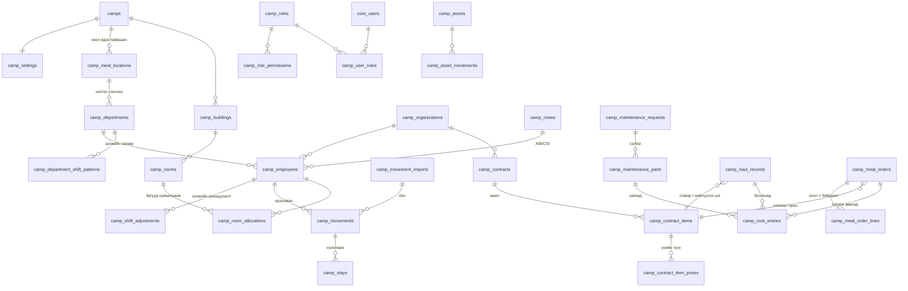

# Кемп удирдлагын модуль (Camp Module) — Төлөвлөгөө ба ERD · v4

> 2026-10-09 · Төлөв: **ERD v4 батлагдсан · Шат 1 ДУУССАН · Шат 2 код + unit ДУУССАН (integration хүлээгдэж байна)** · Хувилбар: БҮРЭН (production) · Өмнөх: `.v1.md`, `.v2.md`, `.v3.md`
> Мөрдөх: `docs/08_Roadmap/00_rules_and_context.md` (RULE-01~20), `docs/03_Data_Models_and_Security/03_Module_Template.md`,
> lessons_learned [RLS-004] (PERMISSIVE TO app_user + FORCE + GRANT), [MIG-001] (`prisma db push` ХОРИОТОЙ — зөвхөн supabase migration)

## 1. Бизнесийн шаардлага (батлагдсан)

| # | Шийдвэр |
|---|---|
| Эрх | **Админ бүх эрхийг тохируулна** (role → permission). Анхдагч 3 роль: Кемп админ, Кемп менежер, Катеринг админ — засах боломжтой |
| Үнэ | Үнийн цорын ганц эх сурвалж = **гэрээ**; гэрээ бүр өөрийн нэгжтэй (рейс / м³ / тн / хүн-өдөр) |
| Гэрээний давхардал | Нэг үйлчилгээнд олон идэвхтэй гэрээ байж болно → бүртгэл бүр дээр гэрээг **сонгоно** |
| НӨАТ | Тооцоолно; үнэ НӨАТ-тай/гүй эсэх гэрээний мөр бүрт; хувь хэмжээг тохиргоонд (анхдагч 10%) |
| Хоол | 4 хоол: өглөө, өдөр, орой, шөнө. Хүн өдөрт 3 хоол → нийт хоол ÷ 3 = хүн-өдөр × гэрээний үнэ |
| Өдөр/шөнийн ээлж | **Хэлтэс дээр ээлжийн загвар** тохируулна (жнь Уулын хэсэг: эхний 7 өдөр өдөр, сүүлийн 7 өдөр шөнө; Захиргаа: 14 хоног өдөр) |
| Ээлжийн зохицуулалт | Ажилтан тус бүрээр загварыг дарж тохируулна: ээлжээсээ өмнө ирж ажиллаж буй хүний өдөр/шөнө, өдрийнх байх ёстой хүнийг шөнө ажиллуулах г.м. |
| Хоол — өдрийн ээлж | Өглөө, **Өдөр**, Орой |
| Хоол — шөнийн ээлж | Өглөө, Орой, **Шөнө**. Шөнийн ээлж эхлэх өдөр (Пүрэв) нэмж **өдрийн хоол** иднэ |
| Хэлтэс | Хэлтэс бүр **хоол идэх байршилтай** (үүсгэх, засахдаа сонгоно/солино). Жнь: Уул засвар → Уулын хэсэг; Захиргаа, ХН → Кемп |
| Хоол идэх байршил | Тохиргоо хэсэгт үүсгэнэ |
| Хоолны урсгал | Кемп менежер маргаашийн тоог хянаж захиална → катеринг админ хүлээн авна → **хүлээн авсны дараа** зардалд орно |
| Бохир ус / хог | Катеринг үүсгэнэ (тээврийн + **нийлүүлэх цэг**-ийн гэрээт байгууллага сонгоно) → кемп менежер батална |
| Засвар | Ажлын хөлс үнэгүй; сэлбэг уурхайгаас. Катеринг **өөрөө авсан** сэлбэгийг тоо, үнэтэй бүртгэнэ → зардалд орно |
| Өрөө | Багтаамжийг өрөө бүрээр; сул/дүүрсэн харагдана. Ээлж солигдоход **багууд өрөөг хуваалцана** |
| Ростер | 4 баг, 14/14. Лхагва солигдоно: ирж буй баг оройн хоолноос, бууж буй баг өглөөний хоол идээд явна. Ээлжийн бусаар ирвэл хоолоо сонгоно |
| Ирц импорт | Кемп менежер xlsx-ээр (ажилтны кодоор) импортлоно |

## 2. ERD

### 2.1 Хүснэгтүүд (бүгд `id UUID uuid_generate_v7()`, `tenant_id`, `created_at`, `updated_at`, RLS)

**Эрхийн тохиргоо (RBAC)** *(шинэ — `UserRole` enum-ийг өөрчлөхгүй)*
- Permission каталог кодонд тогтмол (жнь `camp.settings.manage`, `camp.roles.manage`, `camp.contract.manage`, `camp.employee.manage`,
  `camp.movement.import`, `camp.shift.adjust`, `camp.room.manage`, `camp.asset.manage`, `camp.maintenance.create`,
  `camp.maintenance.parts`, `camp.maintenance.close`, `camp.haul.create`, `camp.haul.approve`, `camp.meal.order`, `camp.meal.accept`, `camp.report.view`)
- `camp_roles` — name, description, is_system (анхдагч роль: устгах боломжгүй, эрхийг нь засаж болно) · UNIQUE(tenant, name)
- `camp_role_permissions` — role_id, permission_code (CHECK: каталогт байгаа код) · PK(role, code)
- `camp_user_roles` — user_id (`core_users.id`, RULE-13), role_id, camp_id? (null = бүх кемп)
- Tenant-ийн `OWNER`/`ADMIN` (одоогийн UserRole) → кемпийн бүх эрхтэй + роль тохируулна (эхний тохиргоо хийх боломж)
- Helper `requireCampPermission(tx, tenantId, authId, campId, code)` → `core_users.id` буцаана; Redis cache, роль өөрчлөгдөхөд invalidate
- Хяналтын дүрэм: бүртгэл үүсгэсэн хүн өөрийнхөө бүртгэлийг батлахгүй

**Тохиргоо ба мастер өгөгдөл**
- `camps` — code, name, location, is_active
- `camp_settings` — camp_id (1:1), vat_rate (10), changeover_weekday (3 = Лхагва), roster_on_days (14), roster_off_days (14), meal_order_cutoff_time, default_meal_location_id (кемп гал тогоо)
- `camp_meal_locations` *(шинэ)* — camp_id, name (Кемп гал тогоо, Уулын хэсэг …), is_active · UNIQUE(camp, name)
- `camp_departments` *(шинэ)* — camp_id, code, name, **meal_location_id**, is_active · UNIQUE(camp, code)
- `camp_department_shift_patterns` *(шинэ)* — department_id, day_from, day_to (ээлжийн 1..14 дэх өдөр), shift `DAY|NIGHT`
  - CHECK 1 ≤ day_from ≤ day_to ≤ roster_on_days; хэлтсийн мөрүүд 1..14-ийг **давхцалгүй, цоорхойгүй** бүрхэнэ (хадгалахад шалгана)
  - Жнь Уулын хэсэг: (1–7, DAY), (8–14, NIGHT) · Захиргаа: (1–14, DAY)
  - Ээлжийн өдрийн дугаар: багийн ирсэн Лхагва = 0, Пүрэв = 1 … явах Лхагва = 14
  - Байршлыг солиход өмнөх захиалга өөрчлөгдөхгүй (захиалгын мөрөнд байршил snapshot-оор хадгалагдана)
- `camp_buildings`, `camp_rooms` (capacity > 0, status `ACTIVE|MAINTENANCE|INACTIVE`)
- `camp_organizations` — name, reg_number, org_type `MAIN|SUBCONTRACTOR|CONTRACTOR`, is_disposal_point, contact, is_active
- `camp_crews` — camp_id, code (A/B/C/D), roster_anchor_date (энэ багийн ирэх нэг Лхагва)
- `camp_employees` — organization_id, department_id, crew_id?, employee_code (импортын түлхүүр), full_name, position, phone, status

**Цагийн бүртгэл / ирц**
- `camp_shift_adjustments` *(шинэ — ээлжийн зохицуулалт)* — employee_id, start_date, end_date, shift `DAY|NIGHT`,
  reason_type `EARLY_ARRIVAL|SHIFT_CHANGE|OTHER`, reason, created_by · EXCLUDE давхцал (employee, daterange)
- **D өдрийн ээлж тодорхойлох дараалал:** 1) зохицуулалт → 2) хэлтсийн загвар × ээлжийн өдрийн дугаар → 3) аль нь ч үгүй (жнь ээлжээс өмнө ирсэн, зохицуулалт хийгээгүй) бол **"ээлж тодорхойгүй"** анхааруулга хоолны захиалга дээр гарна (чимээгүй таамаглахгүй)
- `camp_movement_imports` — file_name, uploaded_by, total/ok/error_rows, errors JSONB, status `PREVIEW|CONFIRMED|CANCELLED`
- `camp_movements` — employee_id, camp_id, movement_date, direction `ARRIVAL|DEPARTURE`, kind `ROSTER|OFF_ROSTER` (автомат), meals text[], import_id? · UNIQUE(employee, date, direction)
  - ROSTER ирэлт → `{DINNER}`, ROSTER явалт → `{BREAKFAST}`, OFF_ROSTER → сонгосон хоол
- `camp_stays` *(шинэ)* — employee_id, camp_id, arrival_movement_id, departure_movement_id?, start_date, end_date? · EXCLUDE давхцал
  - Ирэлт → нээнэ, явалт → хаана. **Байгаа эсэх**-ийн цорын ганц эх сурвалж
- xlsx: `employee_code | date | ИРСЭН/ЯВСАН | хоол (заавал биш: Ө,Ө,О,Ш) | ээлж (заавал биш: ӨДӨР/ШӨНӨ)` → PREVIEW (мөрийн алдаа) → CONFIRM (нэг transaction)

**Өрөө (багууд хуваалцана)**
- `camp_room_allocations` — room_id, employee_id, start_date, end_date? — ажилтны **үндсэн өрөө** · EXCLUDE давхцал (employee)
  - Нэг өрөөнд өөр өөр багийн ажилтнууд хуваарилагдана
  - Хуваарилахад шалгалт: ростерын дагуу дараагийн 28 хоногийн аль ч өдөр **тэнд байх** хүний тоо ≤ capacity (хэтэрвэл өдрийг нэрлэж 409)
- Дүүргэлт (D өдөр) = тухайн өрөөнд хуваарилагдсан **ба** `camp_stays`-аар байгаа хүн → `VACANT | PARTIAL | FULL`
- Ээлжийн бусаар ирэхэд өрөө дүүрсэн бол "өрөөгүй" жагсаалтад орж менежер байршуулна

**Үндсэн хөрөнгө** — `camp_asset_categories`, `camp_assets`, `camp_asset_movements` (өмнөхтэй адил)

**Засвар** — `camp_maintenance_requests`, `camp_maintenance_parts` (source `MINE_SUPPLIED|CATERING_PURCHASED`; зөвхөн CATERING_PURCHASED нь CLOSED болоход зардалд)

**Гэрээ** — `camp_contracts`, `camp_contract_items` (`SEWAGE_TRANSPORT|SEWAGE_DISPOSAL|WASTE_TRANSPORT|WASTE_DISPOSAL|MEAL`; `TRIP|M3|TON|PERSON_DAY`), `camp_contract_item_prices` (effective_from, unit_price, vat_included)

**Бохир ус / хог** — `camp_haul_records` (transport_contract_item_id, disposal_contract_item_id, `DRAFT|SUBMITTED|APPROVED|REJECTED`, APPROVED-г trigger хамгаална)

**Хоолны захиалга** *(бүтэц өөрчлөгдсөн)*
- `camp_meal_orders` — camp_id, order_date, meal_contract_item_id, status `DRAFT|ORDERED|ACCEPTED|REJECTED`, ordered_by, accepted_by, note · UNIQUE(tenant, camp, order_date)
- `camp_meal_order_lines` — order_id, meal_type `BREAKFAST|LUNCH|DINNER|NIGHT`, meal_location_id, base_count (тооцоолсон snapshot), extra_count, extra_note · UNIQUE(order, meal_type, location)
- **Суурь тооцоо (D өдөр, ажилтан бүрээр):**
  | Байдал | Хоол |
  |---|---|
  | Бүтэн өдөр, **ӨДӨР** ээлж | Өглөө (кемп), **Өдөр (хэлтсийн байршил)**, Орой (кемп) |
  | Бүтэн өдөр, **ШӨНӨ** ээлж | Өглөө (кемп), Орой (кемп), **Шөнө (хэлтсийн байршил)** |
  | Шөнийн ээлжийн **эхний өдөр** = D өдөр ШӨНӨ **ба** D−1 өдөр ШӨНӨ биш (өдрийн ээлж, эсвэл кемпэд байгаагүй) | дээрх + **Өдөр (кемп)** |
  - Хамаарах бүх тохиолдол: хэлтсийн загвар (7/7 → Пүрэв), зохицуулалтаар өдрөөс шөнө рүү шилжсэн, ээлжийн бусаар ирсэн
  - Жишээ: Даваа гарагт ээлжийн бусаар өдөр ирж шөнө гарах → **Даваа** өдрийн хоол иднэ, **Мягмар** иднэ (Өглөө, Орой, Шөнө) — өдрийн хоолгүй
  - Ээлжийн бус ирэлтийн өдөр: xlsx/UI-д хоол сонгоогүй бол энэ дүрмээр **автоматаар санал болгоно**; сонгосон бол сонголт давамгайлна
  | D өдөр ирсэн / явсан | `camp_movements.meals`; ажлын хоол бол хэлтсийн байршил |
  *(кемп = `camp_settings.default_meal_location_id`)*
- Захиалга дээр менежер мөр бүрийн **байршлыг** өөрчлөх, шинэ (хоол × байршил) мөр нэмэх боломжтой
- Захиалгын дэлгэцэнд задаргаа: хэлтэс × ээлж × хоол (яагаад ийм тоо гарсныг харуулна)
- Хүн-өдөр = Σ(base + extra) ÷ 3

**Нэгдсэн зардал** — `camp_cost_entries` (source `HAUL|MEAL|MAINTENANCE_PART`, quantity, unit_price, net/vat/gross, vat_rate) — тайлангийн цорын ганц эх сурвалж, батлах/хүлээн авах/хаах үеийн snapshot

### 2.2 Анхдагч ролиуд (админ засна)
| Permission | Кемп админ | Кемп менежер | Катеринг админ |
|---|---|---|---|
| settings / roles / contract / master | ✅ | | |
| employee.manage, room.manage, asset.manage | ✅ | | ✅ |
| movement.import, shift.adjust | ✅ | ✅ | |
| haul.create, maintenance.parts | | | ✅ |
| haul.approve, maintenance.close, meal.order | | ✅ | |
| meal.accept | | | ✅ |
| maintenance.create, report.view | ✅ | ✅ | ✅ |

### 2.3 Шат 1-ийн техникийн шийдвэрүүд (2026-10-09, Lead Dev — хэрэглэгч эрх олгосон)
| # | Шийдвэр | Шалтгаан |
|---|---|---|
| D1 | Төлөв/төрөл → PostgreSQL native enum (`Camp*`), утга = Prisma нэр | RULE-02 (`import { CampHaulStatus } from '@prisma/client'`). Утга нэмэхэд RULE-15, `ADD VALUE` тусдаа migration |
| D2 | Tenant/кемп хоорондын холбоос → `(tenant_id, x_id)` / `(tenant_id, camp_id, x_id)` composite FK; эх хүснэгтэд `UNIQUE (tenant_id, id)`; `core_users`-д `uq_core_users_tenant_id` нэмсэн | App superuser-ээр ажилладаг тул RLS bypass [RLS-004] — FK нь bypass-гүй. Өөр кемпийн байршил/өрөө/гэрээ сонгох боломжгүй |
| D3 | Анхдагч 3 роль → `camp_seed_default_roles()` + `tenants` AFTER INSERT trigger + backfill. Idempotent, админы зассан эрхийг дарахгүй | Шинэ tenant бүр шууд ажиллах боломжтой |
| D4 | `camp_cost_entries` → 3 nullable FK + `chk_camp_cost_source`; partial unique (давхар бичихгүй); засагдахгүй (trigger) | Тайлангийн snapshot |
| D5 | Permission каталог → tenant-гүй `camp_permissions` хүснэгт (CHECK биш), 17 код (`camp.master.manage` нэмсэн — ERD 2.2-ын "master") | Тайлбар/эрэмбэтэй (UI матриц), FK-ээр хамгаалагдана, шинэ эрх = 1 INSERT. Шат 2.1-ийн кодын каталог үүнтэй тестээр тулгагдана |
| D6 | Устгах: tenant → бүх camp_* CASCADE; хүснэгт хооронд NO ACTION (идэвхгүй болгоно); эзэмшигч→дэд (role→perms, order→lines, request→parts, contract→items→prices, asset→movements) CASCADE. Хамгаалах trigger-үүд tenant устгах CASCADE-ийг блоклохгүй (`camp_tenant_exists`) | Integration тест `tenant.delete`-ээр цэвэрлэдэг |
| D7 | Хяналтын дүрэм DB-д: `reviewed_by <> created_by` (haul), `reviewed_by <> ordered_by` (meal) — CHECK | "Үүсгэсэн хүн өөрөө батлахгүй" |

**DB түвшинд хамгаалагдсан:** гэрээний төрөл ↔ haul_type / MEAL (trigger), APPROVED haul · ACCEPTED хоол · CLOSED засвар (+ сэлбэг) түгжигдэнэ, stay ↔ movement чиглэл/огноо (trigger), ээлжийн загвар · зохицуулалт · stay · өрөөний хуваарилалтын давхцал (EXCLUDE), НӨАТ дүн `net + vat = gross`.
**App-д үлдсэн (Шат 2–6):** ээлжийн загварын 1..N цоорхойгүй бүрхэлт, өрөөний 28 хоногийн багтаамж, гэрээ тухайн огноонд ACTIVE + үнэтэй эсэх, нэгж (TRIP/M3/TON) ↔ volume_unit, ажилтан/хэлтэс идэвхтэй эсэх.

## 3. Хийх ажлын төлөвлөгөө

### Шат 0 — Дизайн
- [x] 0.1 Шаардлага тодруулах
- [x] 0.2a ERD v1 · [x] 0.2b ERD v2
- [x] 0.2c ERD v3
- [x] 0.2d ERD v4 батлагдсан (2026-10-09)
- [x] 0.3 Бүх асуулт хариулагдсан (2026-10-09)

### Шат 1 — Database (supabase migrations)
- [x] 1.1 `20261009001_camp_rbac.sql` — camp_permissions (каталог), roles, role_permissions, user_roles, seed функц + tenants trigger, туслах функцууд
- [x] 1.2 `20261009002_camp_master.sql` — camps, settings, meal_locations, departments, department_shift_patterns, buildings, rooms, organizations, crews, employees
- [x] 1.3 `20261009003_camp_attendance.sql` — shift_adjustments, movement_imports, movements, stays (+ validate trigger), room_allocations (btree_gist EXCLUDE)
- [x] 1.4 `20261009004_camp_assets_maintenance.sql` — asset_categories, assets, asset_movements, maintenance_requests, maintenance_parts (+ түгжих trigger)
- [x] 1.5 `20261009005_camp_contracts.sql` — contracts, contract_items, contract_item_prices
- [x] 1.6 `20261009006_camp_operations.sql` — haul_records, meal_orders, meal_order_lines, cost_entries + trigger-үүд
- [x] 1.7 RLS [RLS-004] + GRANT бүх 30 tenant хүснэгтэд (`camp_apply_tenant_rls`); анхдагч ролиуд tenant бүрт (trigger + backfill)
- [x] 1.8a Prisma schema: 31 model, 22 enum, `@db.Uuid`, `Decimal`, composite relation, Tenant/CoreUser back-relation
- [x] 1.8b Шалгалт (цэвэр PG): 24 migration + seed.sql → `supabase/dev/camp_schema_test.sql` 97/97 ✅ (app_user + RLS), mutation 8/8 баригдсан,
      Prisma validate ✅ (prisma-schema-wasm 5.22), Prisma ↔ DB тулгалт: 31 хүснэгт — зөрүүгүй
- [x] 1.8c Local (2026-10-09): `supabase migration up` ✅ → `pnpm db:generate` ✅ → camp_schema_test.sql 97/97 ✅ (supabase_admin) → `tsc --noEmit` ✅ (ENV-010 засварын дараа)

### Шат 2 — Backend: эрх, тохиргоо, мастер өгөгдөл
- [x] 2.1 `camp/common`: `CAMP_PERMISSIONS` (17), `CampAccessService.require/requireAccess` (OWNER/ADMIN = бүх эрх; Redis 5 мин, хэрэглэгчийг хүсэлт бүрт DB-ээс), `inTenantTx` (RULE-04), `camp-errors` (P2002→409, P2003→400, trigger/EXCLUDE→409, CHECK→400)
- [x] 2.2 `camp-rbac` (роль CRUD, эрхийн багц солих, хэрэглэгчид роль; системийн роль устгахгүй; өөрчлөлт бүрт cache цэвэрлэнэ)
- [x] 2.3 `camp-settings` (тохиргоо PUT, хоол идэх байршил; загвартай хэлтэс байхад ростерын урт солих → 409)
- [x] 2.4 `camp-master` (кемп [+ анхдагч тохиргоо], байр/өрөө, байгууллага, хэлтэс + ээлжийн загвар [1..N цоорхойгүй], баг [солигдох гараг], ажилтан [cursor])
- [x] 2.5a Unit 76 тест (нийт 306 ✅), бохир env ✅, mutation 24/24 баригдсан, HTTP wiring (DB-гүй, swc) 8/8 ✅
- [ ] 2.5b Integration: `test/camp-master.integration.spec.ts` (бодит DB + Auth + RLS + camp-errors бодит Prisma алдаан дээр) ← **хэрэглэгчийн машин дээр**
- [x] 2.6 `tsc --noEmit` ✅, `eslint` (camp: 0 анхааруулга)

#### Шат 2 — API (`/api/v1/camp/...`, эрх)
| Endpoint | Эрх |
|---|---|
| `GET permissions`, `GET me/permissions?campId=` | нэвтэрсэн |
| `GET users`, `GET/POST roles`, `PATCH/DELETE roles/:id`, `PUT roles/:id/permissions`, `GET/POST user-roles`, `DELETE user-roles/:id` | `roles.manage` (бүх кемпийн) |
| `GET camps` (эрхтэй кемпүүд), `GET camps/:campId` | тухайн кемпэд аль нэг эрх |
| `POST camps` | `master.manage` (бүх кемпийн) · `PATCH camps/:campId` — тухайн кемпийн |
| `GET/PUT camps/:campId/settings`, `GET/POST/PATCH .../meal-locations` | унших: кемпийн эрх · бичих: `settings.manage` |
| `.../buildings`, `.../departments`, `PUT .../departments/:id/shift-pattern`, `.../crews` | бичих: `master.manage` |
| `.../rooms` | бичих: `room.manage` эсвэл `master.manage` |
| `GET/POST/PATCH organizations` (tenant түвшин) | унших: аль нэг кемпэд эрх · бичих: `master.manage` (бүх кемпийн) |
| `GET .../employees` (cursor: limit, departmentId, crewId, organizationId, status, q), `GET/POST/PATCH .../employees[/:id]` | бичих: `employee.manage` |

Дүрэм: мастер өгөгдөл устгахгүй (`isActive`/`status`); идэвхтэй хамааралтай бол идэвхгүй болгох → 409. Кемп/байрны `code` өөрчлөгдөхгүй.

### Шат 3 — Backend: цагийн бүртгэл, ирц, өрөө
- [ ] 3.1 `exceljs` нэмэх, upload (`FileInterceptor`, хэмжээ/төрөл хязгаар)
- [ ] 3.2 `RosterService` (солигдох өдөр, ROSTER/OFF_ROSTER)
- [ ] 3.3 Ирц импорт PREVIEW → CONFIRM, stays нээх/хаах, загвар xlsx
- [ ] 3.4 `ShiftResolver` (зохицуулалт → хэлтсийн загвар → тодорхойгүй) + ээлжийн зохицуулалт CRUD (бөөнөөр)
- [ ] 3.5 Өрөө хуваарилалт (28 хоногийн багтаамжийн шалгалт), өрөөний самбар, "өрөөгүй" жагсаалт
- [ ] 3.6 `PresenceService` — D өдрийн (хоол × байршил) суурь тоо
- [ ] 3.7 Тест: Лхагвын ирэлт/явалт, ээлжийн бус, 7/7 загвар, Пүрэвийн өдрийн хоол, зохицуулалт загварыг дарах, тодорхойгүй ээлж, хэлтсийн байршил, хуваалцсан өрөө → ногоон

### Шат 4 — Backend: хөрөнгө, засвар (+ сэлбэгийн зардал) → тест ногоон
### Шат 5 — Backend: гэрээ, `ContractPricingService`, `VatCalculator`, `CostEntryWriter` → тест ногоон
### Шат 6 — Backend: бохир ус / хог / хоолны захиалга (ORDERED → ACCEPTED) → тест ногоон
### Шат 7 — Backend: зардлын тайлан (байгууллага → гэрээ → үйлчилгээ, net/НӨАТ/нийт), тооцоо нийлэх акт, Excel → тест ногоон

### Шат 8 — Frontend (web-shell)
- [ ] 8.1 Тохиргоо: кемп, НӨАТ, ростер, **хоол идэх байршил**, **хэлтэс + ээлжийн загвар** (14 хоногийн шугам дээр өдөр/шөнө), байгууллага, гэрээ + үнэ
- [ ] 8.2 **Эрхийн тохиргоо**: роль × permission матриц, хэрэглэгчид роль оноох
- [ ] 8.3 Ажилтан, **цагийн бүртгэл** (ажилтан × өдөр календарь: өдөр/шөнө), **ээлжийн зохицуулалт**, ирц xlsx импорт
- [ ] 8.4 Өрөөний самбар, хуваарилалт
- [ ] 8.5 Хөрөнгө, засвар + сэлбэг
- [ ] 8.6 Бохир ус/хог + батлах дараалал
- [ ] 8.7 Маргаашийн хоолны захиалга (хоол × байршил) / хүлээн авах
- [ ] 8.8 Зардлын тайлан + Excel
- [ ] 8.9 `tsc --noEmit` + eslint + e2e

### Шат 9 — Баримт
- [ ] 9.1 `CHANGELOG.md`, `00_rules_and_context.md` (RULE-12-ийг [RLS-004]-тэй нийцүүлэх)
- [ ] 9.2 Алдааг `docs/lessons_learned.md`-д

## 4. Нээлттэй асуултууд
- Байхгүй (2026-10-09). Хөгжүүлэлтийн явцад гарвал энд нэмнэ.
