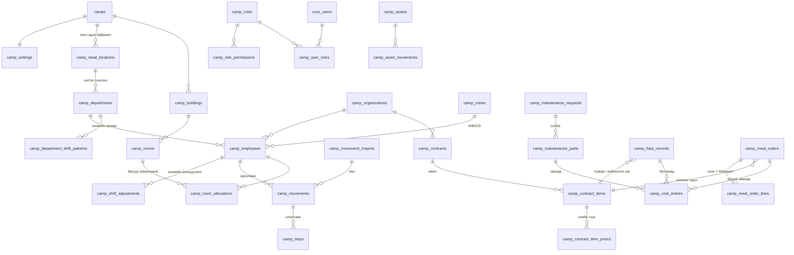

# Кемп удирдлагын модуль (Camp Module) — Төлөвлөгөө ба ERD · v4

> 2026-10-09 · Төлөв: **ERD v4 · V1 ДУУССАН (Шат 1–4, 8, 9 — 2026-10-10) · V2 хүлээгдэж буй (Шат 5–7, D8)** · Хувилбар: БҮРЭН (production) · Өмнөх: `../_archive/camp_module/01_plan_and_erd.v1–v3.md` · **V2 → v0.2** (`../V.0.2/00_backlog_and_tech_debt.md` V2-01…06)
> Мөрдөх: `docs/08_Roadmap/00_rules_and_context.md` (RULE-01~20), `docs/03_Data_Models_and_Security/03_Module_Template.md`,
> lessons_learned [RLS-004] (PERMISSIVE TO app_user + FORCE + GRANT), [MIG-001] (`prisma db push` ХОРИОТОЙ — зөвхөн supabase migration)

## 1. Бизнесийн шаардлага (батлагдсан)

| # | Шийдвэр |
|---|---|
| Эрх | **Админ бүх эрхийг тохируулна** (role → permission). Анхдагч 3 роль: Кемп админ, Кемп менежер, Катеринг админ — засах боломжтой |
| Үнэ | Үнийн цорын ганц эх сурвалж = **гэрээ**; гэрээ бүр өөрийн нэгжтэй (рейс / м³ / тн / хүн-өдөр) |
| Гэрээний давхардал | Нэг үйлчилгээнд олон идэвхтэй гэрээ байж болно → бүртгэл бүр дээр гэрээг **сонгоно** |
| НӨАТ | Тооцоолно; үнэ НӨАТ-тай/гүй эсэх гэрээний мөр бүрт; хувь хэмжээг тохиргоонд (анхдагч 10%) |
| Хоол | 4 хоол: өглөө, өдөр, орой, шөнө. Хүн өдөрт 3 хоол → нийт хоол ÷ 3 = хүн-өдөр × гэрээний үнэ |
| Өдөр/шөнийн ээлж | **Хэлтэс дээр ээлжийн загвар** тохируулна (жнь Уулын хэсэг: эхний 7 өдөр өдөр, сүүлийн 7 өдөр шөнө; Захиргаа: 14 хоног өдөр) |
| Ээлжийн зохицуулалт | Ажилтан тус бүрээр загварыг дарж тохируулна: ээлжээсээ өмнө ирж ажиллаж буй хүний өдөр/шөнө, өдрийнх байх ёстой хүнийг шөнө ажиллуулах г.м. |
| Хоол — өдрийн ээлж | Өглөө, **Өдөр**, Орой |
| Хоол — шөнийн ээлж | Өглөө, Орой, **Шөнө**. Шөнийн ээлж эхлэх өдөр (Пүрэв) нэмж **өдрийн хоол** иднэ |
| Хэлтэс | Хэлтэс бүр **хоол идэх байршилтай** (үүсгэх, засахдаа сонгоно/солино). Жнь: Уул засвар → Уулын хэсэг; Захиргаа, ХН → Кемп |
| Хоол идэх байршил | Тохиргоо хэсэгт үүсгэнэ |
| Хоолны урсгал | Кемп менежер маргаашийн тоог хянаж захиална → катеринг админ хүлээн авна → **хүлээн авсны дараа** зардалд орно |
| Бохир ус / хог | Катеринг үүсгэнэ (тээврийн + **нийлүүлэх цэг**-ийн гэрээт байгууллага сонгоно) → кемп менежер батална |
| Засвар | Ажлын хөлс үнэгүй; сэлбэг уурхайгаас. Катеринг **өөрөө авсан** сэлбэгийг тоо, үнэтэй бүртгэнэ → зардалд орно |
| Өрөө | Багтаамжийг өрөө бүрээр; сул/дүүрсэн харагдана. Ээлж солигдоход **багууд өрөөг хуваалцана** |
| Ростер | 4 баг, 14/14: **14 ажлын өдөр**, ирэх/явах замын хоног **амралтын 14 хоногт орно** (тодруулга 2026-10-09). Лхагва ирж (оройн хоолноос), 14 хоног ажиллаад **Пүрэв** гарагт явна (өглөөний хоол идээд). Ээлжийн бусаар ирэх/явахад хоолоо **заавал** сонгоно (идэхгүй бол NONE) |
| Ирц импорт | Кемп менежер xlsx-ээр (ажилтны кодоор) импортлоно |

## 2. ERD

### 2.1 Хүснэгтүүд (бүгд `id UUID uuid_generate_v7()`, `tenant_id`, `created_at`, `updated_at`, RLS)

**Эрхийн тохиргоо (RBAC)** *(шинэ — `UserRole` enum-ийг өөрчлөхгүй)*
- Permission каталог кодонд тогтмол (жнь `camp.settings.manage`, `camp.roles.manage`, `camp.contract.manage`, `camp.employee.manage`,
  `camp.movement.import`, `camp.shift.adjust`, `camp.room.manage`, `camp.asset.manage`, `camp.maintenance.create`,
  `camp.maintenance.parts`, `camp.maintenance.close`, `camp.haul.create`, `camp.haul.approve`, `camp.meal.order`, `camp.meal.accept`, `camp.report.view`)
- `camp_roles` — name, description, is_system (анхдагч роль: устгах боломжгүй, эрхийг нь засаж болно) · UNIQUE(tenant, name)
- `camp_role_permissions` — role_id, permission_code (CHECK: каталогт байгаа код) · PK(role, code)
- `camp_user_roles` — user_id (`core_users.id`, RULE-13), role_id, camp_id? (null = бүх кемп)
- Tenant-ийн `OWNER`/`ADMIN` (одоогийн UserRole) → кемпийн бүх эрхтэй + роль тохируулна (эхний тохиргоо хийх боломж)
- Helper `requireCampPermission(tx, tenantId, authId, campId, code)` → `core_users.id` буцаана; Redis cache, роль өөрчлөгдөхөд invalidate
- Хяналтын дүрэм: бүртгэл үүсгэсэн хүн өөрийнхөө бүртгэлийг батлахгүй

**Тохиргоо ба мастер өгөгдөл**
- `camps` — code, name, location, is_active
- `camp_settings` — camp_id (1:1), vat_rate (10), changeover_weekday (3 = Лхагва), roster_on_days (14), roster_off_days (14), meal_order_cutoff_time, default_meal_location_id (кемп гал тогоо), catering_organization_id *(Шат 4 — сэлбэгийн зардал үүнд)*
- `camp_meal_locations` *(шинэ)* — camp_id, name (Кемп гал тогоо, Уулын хэсэг …), is_active · UNIQUE(camp, name)
- `camp_departments` *(шинэ)* — camp_id, code, name, **meal_location_id**, is_active · UNIQUE(camp, code)
- `camp_department_shift_patterns` *(шинэ)* — department_id, day_from, day_to (ээлжийн 1..14 дэх өдөр), shift `DAY|NIGHT`
  - CHECK 1 ≤ day_from ≤ day_to ≤ roster_on_days; хэлтсийн мөрүүд 1..14-ийг **давхцалгүй, цоорхойгүй** бүрхэнэ (хадгалахад шалгана)
  - Жнь Уулын хэсэг: (1–7, DAY), (8–14, NIGHT) · Захиргаа: (1–14, DAY)
  - Ээлжийн өдрийн дугаар: багийн ирсэн Лхагва = 0, Пүрэв = 1 … Лхагва = 14 (сүүлийн ажлын өдөр), **явах Пүрэв = 15**; мөчлөг = on + off = 28
  - Байршлыг солиход өмнөх захиалга өөрчлөгдөхгүй (захиалгын мөрөнд байршил snapshot-оор хадгалагдана)
- `camp_buildings`, `camp_rooms` (capacity > 0, status `ACTIVE|MAINTENANCE|INACTIVE`)
- `camp_organizations` — name, reg_number, org_type `MAIN|SUBCONTRACTOR|CONTRACTOR`, service_types `CampOrgServiceType[]` (`CATERING|WASTE_TRANSPORT|SEWAGE_TRANSPORT|WASTE_DISPOSAL|SEWAGE_DISPOSAL|OTHER`; Шат 4-д is_disposal_point-ийг орлосон), contact, is_active
- `camp_crews` — camp_id, code (A/B/C/D), roster_anchor_date (энэ багийн ирэх нэг Лхагва)
- `camp_employees` — organization_id, department_id, crew_id?, employee_code (импортын түлхүүр), full_name, position, phone, status

**Цагийн бүртгэл / ирц**
- `camp_shift_adjustments` *(шинэ — ээлжийн зохицуулалт)* — employee_id, start_date, end_date, shift `DAY|NIGHT`,
  reason_type `EARLY_ARRIVAL|SHIFT_CHANGE|OTHER`, reason, created_by · EXCLUDE давхцал (employee, daterange)
- **D өдрийн ээлж тодорхойлох дараалал:** 1) зохицуулалт → 2) хэлтсийн загвар × ээлжийн өдрийн дугаар → 3) аль нь ч үгүй (жнь ээлжээс өмнө ирсэн, зохицуулалт хийгээгүй) бол **"ээлж тодорхойгүй"** анхааруулга хоолны захиалга дээр гарна (чимээгүй таамаглахгүй)
- `camp_movement_imports` — file_name, uploaded_by, total/ok/error_rows, errors JSONB, status `PREVIEW|CONFIRMED|CANCELLED`
- `camp_movements` — employee_id, camp_id, movement_date, direction `ARRIVAL|DEPARTURE`, kind `ROSTER|OFF_ROSTER` (автомат), meals text[], import_id? · UNIQUE(employee, date, direction)
  - ROSTER ирэлт → `{DINNER}`, ROSTER явалт → `{BREAKFAST}`, OFF_ROSTER → сонгосон хоол
- `camp_stays` *(шинэ)* — employee_id, camp_id, arrival_movement_id, departure_movement_id?, start_date, end_date? · EXCLUDE давхцал
  - Ирэлт → нээнэ, явалт → хаана. **Байгаа эсэх**-ийн цорын ганц эх сурвалж
- xlsx: `employee_code | date | ИРСЭН/ЯВСАН | хоол (заавал биш: Ө,Ө,О,Ш) | ээлж (заавал биш: ӨДӨР/ШӨНӨ)` → PREVIEW (мөрийн алдаа) → CONFIRM (нэг transaction)

**Өрөө (багууд хуваалцана)**
- `camp_room_allocations` — room_id, employee_id, start_date, end_date? — ажилтны **үндсэн өрөө** · EXCLUDE давхцал (employee)
  - Нэг өрөөнд өөр өөр багийн ажилтнууд хуваарилагдана
  - Хуваарилахад шалгалт: ростерын дагуу дараагийн 28 хоногийн аль ч өдөр **тэнд байх** хүний тоо ≤ capacity (хэтэрвэл өдрийг нэрлэж 409)
- Дүүргэлт (D өдөр) = тухайн өрөөнд хуваарилагдсан **ба** `camp_stays`-аар байгаа хүн → `VACANT | PARTIAL | FULL`
- Ээлжийн бусаар ирэхэд өрөө дүүрсэн бол "өрөөгүй" жагсаалтад орж менежер байршуулна

**Үндсэн хөрөнгө** — `camp_asset_categories`, `camp_assets`, `camp_asset_movements` (өмнөхтэй адил)

**Засвар** — `camp_maintenance_requests`, `camp_maintenance_parts` (source `MINE_SUPPLIED|CATERING_PURCHASED`; зөвхөн CATERING_PURCHASED нь CLOSED болоход зардалд); хүсэлт `blocks_room` *(Шат 4)* — өрөөг засварт оруулах эсэх

**Гэрээ** — `camp_contracts`, `camp_contract_items` (`SEWAGE_TRANSPORT|SEWAGE_DISPOSAL|WASTE_TRANSPORT|WASTE_DISPOSAL|MEAL`; `TRIP|M3|TON|PERSON_DAY`), `camp_contract_item_prices` (effective_from, unit_price, vat_included)

**Бохир ус / хог** — `camp_haul_records` (transport_contract_item_id, disposal_contract_item_id, `DRAFT|SUBMITTED|APPROVED|REJECTED`, APPROVED-г trigger хамгаална)

**Хоолны захиалга** *(бүтэц өөрчлөгдсөн)*
- `camp_meal_orders` — camp_id, order_date, meal_contract_item_id, status `DRAFT|ORDERED|ACCEPTED|REJECTED`, ordered_by, accepted_by, note · UNIQUE(tenant, camp, order_date)
- `camp_meal_order_lines` — order_id, meal_type `BREAKFAST|LUNCH|DINNER|NIGHT`, meal_location_id, base_count (тооцоолсон snapshot), extra_count, extra_note · UNIQUE(order, meal_type, location)
- **Суурь тооцоо (D өдөр, ажилтан бүрээр):**
  | Байдал | Хоол |
  |---|---|
  | Бүтэн өдөр, **ӨДӨР** ээлж | Өглөө (кемп), **Өдөр (хэлтсийн байршил)**, Орой (кемп) |
  | Бүтэн өдөр, **ШӨНӨ** ээлж | Өглөө (кемп), Орой (кемп), **Шөнө (хэлтсийн байршил)** |
  | Шөнийн ээлжийн **эхний өдөр** = D өдөр ШӨНӨ **ба** D−1 өдөр ШӨНӨ биш (өдрийн ээлж, эсвэл кемпэд байгаагүй) | дээрх + **Өдөр (кемп)** |
  - Хамаарах бүх тохиолдол: хэлтсийн загвар (7/7 → Пүрэв), зохицуулалтаар өдрөөс шөнө рүү шилжсэн, ээлжийн бусаар ирсэн
  - Жишээ: Даваа гарагт ээлжийн бусаар өдөр ирж шөнө гарах → **Даваа** өдрийн хоол иднэ, **Мягмар** иднэ (Өглөө, Орой, Шөнө) — өдрийн хоолгүй
  - Ээлжийн бус ирэлтийн өдөр: xlsx/UI-д хоол сонгоогүй бол энэ дүрмээр **автоматаар санал болгоно**; сонгосон бол сонголт давамгайлна
  | D өдөр ирсэн / явсан | `camp_movements.meals`; ажлын хоол бол хэлтсийн байршил |
  *(кемп = `camp_settings.default_meal_location_id`)*
- Захиалга дээр менежер мөр бүрийн **байршлыг** өөрчлөх, шинэ (хоол × байршил) мөр нэмэх боломжтой
- Захиалгын дэлгэцэнд задаргаа: хэлтэс × ээлж × хоол (яагаад ийм тоо гарсныг харуулна)
- Хүн-өдөр = Σ(base + extra) ÷ 3

**Нэгдсэн зардал** — `camp_cost_entries` (source `HAUL|MEAL|MAINTENANCE_PART`, quantity, unit_price, net/vat/gross, vat_rate) — тайлангийн цорын ганц эх сурвалж, батлах/хүлээн авах/хаах үеийн snapshot

### 2.2 Анхдагч ролиуд (админ засна)
| Permission | Кемп админ | Кемп менежер | Катеринг админ |
|---|---|---|---|
| settings / roles / contract / master | ✅ | | |
| employee.manage, room.manage, asset.manage | ✅ | | ✅ |
| movement.import, shift.adjust | ✅ | ✅ | |
| haul.create, maintenance.parts | | | ✅ |
| haul.approve, maintenance.close, meal.order | | ✅ | |
| meal.accept | | | ✅ |
| maintenance.create, report.view | ✅ | ✅ | ✅ |

### 2.3 Шат 1-ийн техникийн шийдвэрүүд (2026-10-09, Lead Dev — хэрэглэгч эрх олгосон)
| # | Шийдвэр | Шалтгаан |
|---|---|---|
| D1 | Төлөв/төрөл → PostgreSQL native enum (`Camp*`), утга = Prisma нэр | RULE-02 (`import { CampHaulStatus } from '@prisma/client'`). Утга нэмэхэд RULE-15, `ADD VALUE` тусдаа migration |
| D2 | Tenant/кемп хоорондын холбоос → `(tenant_id, x_id)` / `(tenant_id, camp_id, x_id)` composite FK; эх хүснэгтэд `UNIQUE (tenant_id, id)`; `core_users`-д `uq_core_users_tenant_id` нэмсэн | App superuser-ээр ажилладаг тул RLS bypass [RLS-004] — FK нь bypass-гүй. Өөр кемпийн байршил/өрөө/гэрээ сонгох боломжгүй |
| D3 | Анхдагч 3 роль → `camp_seed_default_roles()` + `tenants` AFTER INSERT trigger + backfill. Idempotent, админы зассан эрхийг дарахгүй | Шинэ tenant бүр шууд ажиллах боломжтой |
| D4 | `camp_cost_entries` → 3 nullable FK + `chk_camp_cost_source`; partial unique (давхар бичихгүй); засагдахгүй (trigger) | Тайлангийн snapshot |
| D5 | Permission каталог → tenant-гүй `camp_permissions` хүснэгт (CHECK биш), 17 код (`camp.master.manage` нэмсэн — ERD 2.2-ын "master") | Тайлбар/эрэмбэтэй (UI матриц), FK-ээр хамгаалагдана, шинэ эрх = 1 INSERT. Шат 2.1-ийн кодын каталог үүнтэй тестээр тулгагдана |
| D6 | Устгах: tenant → бүх camp_* CASCADE; хүснэгт хооронд NO ACTION (идэвхгүй болгоно); эзэмшигч→дэд (role→perms, order→lines, request→parts, contract→items→prices, asset→movements) CASCADE. Хамгаалах trigger-үүд tenant устгах CASCADE-ийг блоклохгүй (`camp_tenant_exists`) | Integration тест `tenant.delete`-ээр цэвэрлэдэг |
| D7 | Хяналтын дүрэм DB-д: `reviewed_by <> created_by` (haul), `reviewed_by <> ordered_by` (meal) — CHECK | "Үүсгэсэн хүн өөрөө батлахгүй" |
| D8 | **Хамрах хүрээ (2026-10-09, хэрэглэгчийн шийдвэр):** Шат 5 (гэрээ, үнэ), Шат 6 (бохир ус/хог, хоолны захиалга), Шат 7 (зардлын тайлан) → **V2**. V1 = Шат 1–4 → Шат 8 (Шат 2–4-ийн хуудсууд) → Шат 9. DB (Шат 1.5–1.6-ийн хүснэгт, Prisma model, `camp_cost_entries`) **хэвээр** — drop / migration буцаах ХОРИОТОЙ, V2 шууд үргэлжилнэ. V2 эрх (`contract.manage`, `haul.create`, `haul.approve`, `meal.order`, `meal.accept`, `report.view`) каталог/DB-д үлдэж, `GET /camp/permissions`-ийн `availableIn: 'v2'`-оор V1 UI-д нуугдана; эрх шалгалт өөрчлөгдөхгүй | V1-ийг хурдан ашиглалтад гаргах. Хамаарлын шалгалт: Шат 2–4 нь Шат 5–7-ын логикоос хамааралгүй — засвар хаахад `camp_cost_entries` (MAINTENANCE_PART) гэрээгүйгээр бичигдэнэ; `vat.ts`, `cost-entry-writer.ts` Шат 4-т ашиглагдана; тестүүд V2 эрхийг зөвхөн "ямар нэг эрх" болгон ашигладаг. `report.view` 3 анхдагч рольд байгаа ч кемпийн хандалт = ямар нэг эрх тул нуусан ч хандалт өөрчлөгдөхгүй (V1-д "зөвхөн харах" роль хэрэгтэй бол `camp.view` эрх = 1 INSERT) |

**Migration доторх ирээдүйн шатын тайлбар (D8 — V2 гэж уншина):** хэрэгжсэн migration-ийг checksum/түүхтэй зөрөхгүйн тулд өөрчлөөгүй.
`20261009005_camp_contracts.sql` "ContractPricingService, Шат 5" · `20261009006_camp_operations.sql` "Шат 5 VatCalculator" (V1-д `costs/vat.ts` болж хэрэгжсэн), "сторно мөр … Шат 5–6" → бүгд **V2**.

**DB түвшинд хамгаалагдсан:** гэрээний төрөл ↔ haul_type / MEAL (trigger), APPROVED haul · ACCEPTED хоол · CLOSED засвар (+ сэлбэг) түгжигдэнэ, stay ↔ movement чиглэл/огноо (trigger), ээлжийн загвар · зохицуулалт · stay · өрөөний хуваарилалтын давхцал (EXCLUDE), НӨАТ дүн `net + vat = gross`.
**App-д үлдсэн:** V1 (Шат 2–4, хэрэгжсэн) — ээлжийн загварын 1..N цоорхойгүй бүрхэлт, өрөөний 28 хоногийн багтаамж, ажилтан/хэлтэс идэвхтэй эсэх. V2 (Шат 5–6) — гэрээ тухайн огноонд ACTIVE + үнэтэй эсэх, нэгж (TRIP/M3/TON) ↔ volume_unit.

## 3. Хийх ажлын төлөвлөгөө

### Шат 0 — Дизайн
- [x] 0.1 Шаардлага тодруулах
- [x] 0.2a ERD v1 · [x] 0.2b ERD v2
- [x] 0.2c ERD v3
- [x] 0.2d ERD v4 батлагдсан (2026-10-09)
- [x] 0.3 Бүх асуулт хариулагдсан (2026-10-09)

### Шат 1 — Database (supabase migrations)
- [x] 1.1 `20261009001_camp_rbac.sql` — camp_permissions (каталог), roles, role_permissions, user_roles, seed функц + tenants trigger, туслах функцууд
- [x] 1.2 `20261009002_camp_master.sql` — camps, settings, meal_locations, departments, department_shift_patterns, buildings, rooms, organizations, crews, employees
- [x] 1.3 `20261009003_camp_attendance.sql` — shift_adjustments, movement_imports, movements, stays (+ validate trigger), room_allocations (btree_gist EXCLUDE)
- [x] 1.4 `20261009004_camp_assets_maintenance.sql` — asset_categories, assets, asset_movements, maintenance_requests, maintenance_parts (+ түгжих trigger)
- [x] 1.5 `20261009005_camp_contracts.sql` — contracts, contract_items, contract_item_prices
- [x] 1.6 `20261009006_camp_operations.sql` — haul_records, meal_orders, meal_order_lines, cost_entries + trigger-үүд
- [x] 1.7 RLS [RLS-004] + GRANT бүх 30 tenant хүснэгтэд (`camp_apply_tenant_rls`); анхдагч ролиуд tenant бүрт (trigger + backfill)
- [x] 1.8a Prisma schema: 31 model, 22 enum, `@db.Uuid`, `Decimal`, composite relation, Tenant/CoreUser back-relation
- [x] 1.8b Шалгалт (цэвэр PG): 24 migration + seed.sql → `supabase/dev/camp_schema_test.sql` 97/97 ✅ (app_user + RLS), mutation 8/8 баригдсан,
      Prisma validate ✅ (prisma-schema-wasm 5.22), Prisma ↔ DB тулгалт: 31 хүснэгт — зөрүүгүй
- [x] 1.8c Local (2026-10-09): `supabase migration up` ✅ → `pnpm db:generate` ✅ → camp_schema_test.sql 97/97 ✅ (supabase_admin) → `tsc --noEmit` ✅ (ENV-010 засварын дараа)

### Шат 2 — Backend: эрх, тохиргоо, мастер өгөгдөл
- [x] 2.1 `camp/common`: `CAMP_PERMISSIONS` (17), `CampAccessService.require/requireAccess` (OWNER/ADMIN = бүх эрх; Redis 5 мин, хэрэглэгчийг хүсэлт бүрт DB-ээс), `inTenantTx` (RULE-04), `camp-errors` (P2002→409, P2003→400, trigger/EXCLUDE→409, CHECK→400)
- [x] 2.2 `camp-rbac` (роль CRUD, эрхийн багц солих, хэрэглэгчид роль; системийн роль устгахгүй; өөрчлөлт бүрт cache цэвэрлэнэ)
- [x] 2.3 `camp-settings` (тохиргоо PUT, хоол идэх байршил; загвартай хэлтэс байхад ростерын урт солих → 409)
- [x] 2.4 `camp-master` (кемп [+ анхдагч тохиргоо], байр/өрөө, байгууллага, хэлтэс + ээлжийн загвар [1..N цоорхойгүй], баг [солигдох гараг], ажилтан [cursor])
- [x] 2.5a Unit 76 тест (нийт 306 ✅), бохир env ✅, mutation 24/24 баригдсан, HTTP wiring (DB-гүй, swc) 8/8 ✅
- [x] 2.5b Integration: `test/camp-master.integration.spec.ts` 25/25 ✅ (2026-10-09, PRISMA-003 засварын дараа)
- [x] 2.6 `tsc --noEmit` ✅, `eslint` (camp: 0 анхааруулга)

#### Шат 2 — API (`/api/v1/camp/...`, эрх)
| Endpoint | Эрх |
|---|---|
| `GET permissions`, `GET me/permissions?campId=` | нэвтэрсэн |
| `GET users`, `GET/POST roles`, `PATCH/DELETE roles/:id`, `PUT roles/:id/permissions`, `GET/POST user-roles`, `DELETE user-roles/:id` | `roles.manage` (бүх кемпийн) |
| `GET camps` (эрхтэй кемпүүд), `GET camps/:campId` | тухайн кемпэд аль нэг эрх |
| `POST camps` | `master.manage` (бүх кемпийн) · `PATCH camps/:campId` — тухайн кемпийн |
| `GET/PUT camps/:campId/settings`, `GET/POST/PATCH .../meal-locations` | унших: кемпийн эрх · бичих: `settings.manage` |
| `.../buildings`, `.../departments`, `PUT .../departments/:id/shift-pattern`, `.../crews` | бичих: `master.manage` |
| `.../rooms` | бичих: `room.manage` эсвэл `master.manage` |
| `GET/POST/PATCH organizations` (tenant түвшин) | унших: аль нэг кемпэд эрх · бичих: `master.manage` (бүх кемпийн) |
| `GET .../employees` (cursor: limit, departmentId, crewId, organizationId, status, q), `GET/POST/PATCH .../employees[/:id]` | бичих: `employee.manage` |

Дүрэм: мастер өгөгдөл устгахгүй (`isActive`/`status`); идэвхтэй хамааралтай бол идэвхгүй болгох → 409. Кемп/байрны `code` өөрчлөгдөхгүй.

### Шат 3 — Backend: цагийн бүртгэл, ирц, өрөө
- [x] 3.0 Migration `20261010001` (`parsed_rows`, `roster_off_days ≥ 2`); `@fastify/multipart` 8.3.1 + `exceljs` 4.4.0; `registerMultipart` (main.ts + тест)
- [x] 3.1 `roster.ts` (өдрийн дугаар 0..on+1, ROSTER/OFF_ROSTER, хоногоор байх эсэх)
- [x] 3.2 `ShiftResolver` (зохицуулалт → загвар → багагүй бол нэг ээлжтэй загвар → UNKNOWN) + зохицуулалт (бөөнөөр) + ээлжийн календарь
- [x] 3.3 Ирц: xlsx задлагч (англи/монгол), `planImport` (цэвэр, PREVIEW/CONFIRM/гараар нэг дүрэм), CONFIRM all-or-nothing + advisory lock, загвар xlsx, гараар бүртгэх/сүүлийнхийг устгах
- [x] 3.4 Өрөө: хуваарилах (28 шөнийн багтаамж, хоногоор), шилжүүлэх (replaceCurrent), дуусгах, самбар, "өрөөгүй"
- [x] 3.5 `PresenceService` — D өдрийн хоол × байршил, задаргаа, хүн-өдөр, анхааруулга (тодорхойгүй ээлж, анхдагч байршилгүй)
- [x] 3.6a Unit 130 (нийт 362), mutation 26/27 (1 нь equivalent), HTTP wiring 14/14 (multipart, 413, VALID-001)
- [x] 3.6b Integration: `camp-attendance` 15/15 + `camp-master` 25/25 ✅ (2026-10-09, main.ts-тэй ижил pipe)
- [x] 3.7 `tsc`, `eslint`, баримт

#### Шат 3 — шийдвэрүүд (2026-10-09, хэрэглэгч баталсан)
- xlsx багана/утга англи (монгол ч хүлээн авна): `employee_code | date | direction (ARRIVAL/DEPARTURE) | meals (BREAKFAST,LUNCH,DINNER,NIGHT | NONE) | shift (DAY/NIGHT)`
- `shift` зөвхөн ARRIVAL мөрөнд → ирсэн өдрөөс (тухайн файл дахь) явах өдөр хүртэл, эсвэл +`roster_on_days` хоног ээлжийн зохицуулалт
- Ээлжийн бус ирэлт/явалт: хоол ЗААВАЛ (`NONE` = идэхгүй). Ростерын: хоосон бол ирэлт → DINNER, явалт → BREAKFAST
- Багагүй ажилтан: загвар нэг ээлжтэй бол түүгээр, бусад үед зохицуулалтгүй → тодорхойгүй; өрөөний багтаамжид шөнө бүр тоологдоно
- Шөнийн эхний өдөр: D ШӨНӨ ба D−1 шөнө ШӨНИЙН ээлжээр хонож байгаагүй (ирсэн өдөр ч тооцогдоно — ERD-ийн "Даваа ирж шөнө гарах" жишээ)
- Өрөө "хоногоор": солигдох Лхагва шөнө ирж буй + явах баг хоёулаа хононо → хуваалцсан өрөө тэр шөнө хоёуланд хүрэлцэх ёстой

#### Шат 3 — API (`/api/v1/camp/camps/:campId/...`)
| Endpoint | Эрх |
|---|---|
| `GET movement-imports/template`, `POST movement-imports` (multipart `file`, ≤ 2 MB, ≤ 5000 мөр), `GET movement-imports[/:id]`, `POST .../:id/confirm`, `POST .../:id/cancel` | `movement.import` |
| `GET movements?from&to&employeeId` (≤ 93 хоног), `POST movements`, `DELETE movements/:id` (зөвхөн сүүлийнх) | унших: кемп · бичих: `movement.import` |
| `GET stays?date=` | кемп |
| `GET shift-adjustments?from&to`, `POST shift-adjustments` (бөөнөөр), `DELETE shift-adjustments/:id`, `GET shift-calendar?from&to&departmentId&crewId` (≤ 31 хоног) | бичих: `shift.adjust` |
| `GET room-allocations`, `POST room-allocations`, `POST room-allocations/:id/end`, `GET room-board?date=` | бичих: `room.manage` |
| `GET presence?date=` | кемп |

### Шат 4 — Backend: хөрөнгө, засвар (+ сэлбэгийн зардал)
- [x] 4.0 [VALID-001] үлдэгдэл: `configureApp` (pipe + prefix + multipart) — `main.ts` ба БҮХ integration spec нэг функц ашиглана
- [x] 4.1 Migration `20261010002`: `service_types[]` (is_disposal_point → өгөгдөл шилжинэ), `camp_settings.catering_organization_id`, `blocks_room`, сэлбэгийн trigger `FOR SHARE`; байгууллага/тохиргооны API
- [x] 4.2 `costs/vat.ts` (`computeVat`, ROUND_HALF_UP, net + vat = gross) + `cost-entry-writer.ts` (Шат 5-6 дахин ашиглана)
- [x] 4.3 Хөрөнгө: ангилал (tenant), бүртгэл, шилжүүлэх (түүх), актлах
- [x] 4.4 Засвар: `ZAS-` дугаар, төлвийн машин (`maintenance-flow.ts`), өрөөний түгжээ, сэлбэг, хаахад зардал
- [x] 4.5a Unit 46 (нийт 421), mutation 8/8, HTTP wiring 5/5, DB race (хаах ↔ сэлбэг) 2 чиглэлд, tenant CASCADE, app_user RLS
- [x] 4.5b Integration: `camp-assets-maintenance` + бүх хуучин spec (`configureApp`) ✅ (2026-10-09, хэрэглэгчийн машин дээр)
- [x] 4.6 `tsc`, `eslint`, баримт

#### Шат 4 — шийдвэрүүд (2026-10-09, хэрэглэгч баталсан + Lead Dev)
- Байгууллага олон үйлчилгээний төрөлтэй (`service_types`). Кемпийн тохиргооны катеринг байгууллага нь CATERING төрөлтэй, идэвхтэй байх ёстой; ашиглагдаж байхад CATERING-ийг хасах / идэвхгүй болгох → 409
- Засвар үүсгэхдээ `blocksRoom` сонгоно → өрөө `MAINTENANCE`. DONE / CANCELLED болоход өөр түгжих нээлттэй засвар үлдээгүй бол `ACTIVE`; reopen → дахин түгжинэ. Өрөөний мөрийг `FOR UPDATE`-аар түгжиж зэрэгцээ суллалтыг цэгцэлнэ. Түгжээтэй өрөөг гараар MAINTENANCE-ээс гаргах → 409. INACTIVE өрөөг түгжих → 409. Өрөөнд хүн байрлаж байвал `warnings`
- Дугаар `ZAS-{campCode}-{YYYY}-{NNNN}` — кемп+он тус бүр advisory lock; он = Улаанбаатарын огноо; `starts_with` (LIKE биш: код `_` агуулж болно)
- Урсгал: OPEN →start→ IN_PROGRESS →complete→ DONE →close→ CLOSED; DONE →reopen→ IN_PROGRESS; OPEN/IN_PROGRESS →cancel (шалтгаантай)→ CANCELLED. start/complete = `maintenance.parts`, reopen/close = `maintenance.close`, cancel/засах = үүсгэсэн хүн эсвэл `maintenance.close`. Шилжилт бүр `updateMany where status = уншсан` → зэрэгцээ өөрчлөлтөд 409
- Хаах: зөвхөн CATERING_PURCHASED сэлбэг → `camp_cost_entries` (катеринг байгууллага, кемпийн НӨАТ, өнөөдөр, хаасан хүн). Катерингийн сэлбэг байгаа ч катеринг байгууллага тохируулаагүй → 409. Төлвийг ЭХЛЭЭД CLOSED болгоод дараа нь сэлбэг уншина + сэлбэгийн trigger `FOR SHARE` → хаах үеийн зардал сэлбэгийн жагсаалттай үргэлж таарна (2 чиглэлийн race DB дээр шалгагдсан)
- Сэлбэг OPEN / IN_PROGRESS / DONE үед засагдана (хаахаас өмнө залруулах); катерингийн сэлбэгт үнэ заавал
- Хөрөнгө: байршил зөвхөн move / write-off-оор өөрчлөгдөж түүх бичигдэнэ (анхны байршуулалт ч). Актлагдсан хөрөнгө түгжигдэнэ; нээлттэй засвартай хөрөнгийг актлахгүй (409); засварт байгаа өрөөнд хөрөнгө байрлуулж болно. Зөвхөн хөрөнгө өгсөн засвар түүний одоогийн өрөөг авна
- Хөрөнгийн ангилал = tenant түвшний лавлах: аль нэг кемпэд `asset.manage` эрхтэй бол удирдана

#### Шат 4 — API
| Endpoint | Эрх |
|---|---|
| `GET/POST /camp/asset-categories`, `PATCH /camp/asset-categories/:id` | унших: аль нэг кемп · бичих: аль нэг кемпэд `asset.manage` |
| `GET camps/:campId/assets?roomId=<uuid\|warehouse>&categoryId&condition&q&cursor&limit`, `GET .../assets/:id`, `GET .../assets/:id/movements` | кемп |
| `POST .../assets`, `PATCH .../assets/:id`, `POST .../assets/:id/move` (`toRoomId` null = агуулах), `POST .../assets/:id/write-off` (`reason`) | `asset.manage` |
| `GET camps/:campId/maintenance?status&priority&roomId&assetId&q&cursor&limit`, `GET .../maintenance/:id` (сэлбэг + зардлын урьдчилсан тооцоо) | кемп |
| `POST .../maintenance` (`roomId?`, `assetId?`, `title`, `priority?`, `blocksRoom?`) | `maintenance.create` |
| `PATCH .../maintenance/:id` (гарчиг/тайлбар/зэрэглэл), `POST .../:id/cancel` (`reason`) | үүсгэсэн хүн эсвэл `maintenance.close` |
| `POST .../:id/start`, `POST .../:id/complete`, `POST/PATCH/DELETE .../:id/parts[/:partId]` | `maintenance.parts` |
| `POST .../:id/reopen`, `POST .../:id/close` | `maintenance.close` |
### Шат 8 — Frontend (web-shell) · V1 = Шат 2–4-ийн хуудсууд
Бүтэц: `apps/web-shell/src/modules/camp/` (api, hooks, components, lib, pages; `CampRoutes.tsx` → `/camp/*`). Шинэ runtime сан нэмээгүй (vitest = dev, core-kernel-тэй ижил хувилбар).
Хүргэлт 3 багцаар: **Багц 1** = 8.0–8.2 · **Багц 2** = 8.3–8.5 · **Багц 3** = 8.6–8.7. Кемп нээхэд анхдагч хэсэг = Ирц (өдөр тутмын ажиллагаа эхэнд, тохиргоо сүүлд).
- [x] 8.0 Суурь: цэс (`Кемп`), кемп сонгогч, `useCampPermissions` (`/camp/me/permissions` — UI нуух; backend дахин шалгана), API клиент, UI хэрэгслүүд (Field ↔ label холбоотой, Modal, Table, ErrorBox — backend-ийн монгол мессеж), гарсны дараа query cache цэвэрлэнэ
- [x] 8.1 Тохиргоо: кемп, НӨАТ, ростер, **хоол идэх байршил**, **катеринг байгууллага**, байр/өрөө, **хэлтэс + ээлжийн загвар** (14 хоногийн шугам дээр өдөр/шөнө, дутуу өдрийг шууд харуулна), баг (солигдох гараг шалгана), байгууллага (үйлчилгээний төрөл)
- [x] 8.2 **Эрхийн тохиргоо**: роль × permission матриц (`availableIn: 'v2'` эрхийг нууна; хадгалахад роль эзэмшиж буй V2 эрх хасагдахгүй — `mergeRolePermissions`), хэрэглэгчид роль оноох (бүх кемп / кемп)
- [x] 8.B1 Багц 1 шалгалт: `tsc`, eslint, `vite build`, vitest 11 (lib), хуурамч API-тай браузерын шалгалт 12/12 (1400px + 390px), e2e spec dry-run 6/6
- [x] 8.B1e2e `apps/e2e/tests/camp.spec.ts` 6/6 ✅ (2026-10-10, хэрэглэгчийн машин дээр; урьдчилсан нөхцөл: `supabase/dev/camp_e2e_grant.sql`)
- [x] 8.3 Ажилтан (хайлт, шүүлт, цааш ачаалах), **ирц xlsx импорт** (загвар, PREVIEW — анхдагчаар зөвхөн алдаатай мөр, CONFIRM 409-ийн мөрийн алдаа, цуцлах, түүх), гараар ирц (хоол: анхдагч/сонгох/идэхгүй), **ээлжийн календарь** (ажилтан × өдөр ≤ 31: өдөр/шөнө/тодорхойгүй/ирэх/явах/амралт, зохицуулалт = хүрээ, ▲▼ ирсэн/явсан), **ээлжийн зохицуулалт** (олон ажилтан)
- [x] 8.4 Өрөөний самбар (D өдрийн шөнө, байраар, дүүргэлт), "өрөөгүй", хуваарилах / шилжүүлэх (replaceCurrent) / дуусгах
- [x] 8.5 Хоолны суурь тоо (хоол × байршил, нийлбэр, хүн-өдөр, задаргаа, анхааруулга) — зөвхөн харах
- [x] 8.B2 Багц 2 шалгалт: `tsc`, eslint, `vite build`, vitest 19, хуурамч API-тай браузер 13/13 (upload-ийн байт бодит HTTP-ээр), e2e dry-run 7/7 + багц 1-ийн 6/6
- [x] 8.B2e2e `apps/e2e/tests/camp-ops.spec.ts` 7/7 + `camp.spec.ts` 6/6 ✅ (2026-10-10, хэрэглэгчийн машин дээр)
- [x] 8.6 Хөрөнгө (ангилал, шилжүүлэх, актлах), засвар + сэлбэг (өрөө түгжих сонголт, зардлын урьдчилсан тооцоо). Засварын дэлгэрэнгүй = тусдаа хуудас `/camp/:campId/maintenance/:id`; хөрөнгийн дэлгэрэнгүй = modal; хаахаас өмнө нийт зардлыг харуулж баталгаажуулна; мөнгийг string-ээс float-гүй форматлана (`lib/money.ts`)
- [x] 8.7 `tsc --noEmit` + eslint + `vite build` + vitest 27 + хуурамч API-тай браузер (1400px + 390px, хэвтээ гүйлгээгүй) + e2e dry-run 7/7 (`camp-assets.spec.ts`) + багц 1–2-ын dry-run 13/13
- [x] 8.B3e2e `apps/e2e/tests/camp-assets.spec.ts` 7/7 + `camp.spec.ts` 6/6 + `camp-ops.spec.ts` 7/7 = 20/20 ✅; type-check, vitest 27/27 (2026-10-10, хэрэглэгчийн машин дээр)

### Шат 9 — Баримт (V1)
- [x] 9.1 `CHANGELOG.md` (`[Unreleased]` → «Кемп модуль V1»; `v0.2.0` = Air-Gapped тул тусдаа дугаар нээгээгүй), `00_rules_and_context.md` RULE-12 → `AS PERMISSIVE TO app_user` + GRANT ([RLS-004])
- [x] 9.2 `docs/lessons_learned.md` аудит — Шат 1–8-ын алдаа бүгд бүртгэгдсэн; FE-004 (Шат 8 UI) нэмсэн; ID давхцалгүй
- [x] 9.3 `project-status.md` (Кемп модулийн төлөв), `INDEX.md` (кемпийн баримтын холбоос)

---

## V2 — хойшлуулсан (2026-10-09, D8)
> DB хүснэгт, Prisma model, эрхийн код бэлэн (Шат 1.5–1.6) — V2 эдгээр дээр шууд үргэлжилнэ. V1-ийн `costs/vat.ts`, `cost-entry-writer.ts`, `CampPresenceService.compute`-ийг дахин ашиглана.

### Шат 5 — Backend: гэрээ, `ContractPricingService`, (`VatCalculator` = V1 `costs/vat.ts`), `CostEntryWriter` өргөтгөл → тест ногоон
### Шат 6 — Backend: бохир ус / хог / хоолны захиалга (ORDERED → ACCEPTED) → тест ногоон
### Шат 7 — Backend: зардлын тайлан (байгууллага → гэрээ → үйлчилгээ, net/НӨАТ/нийт), тооцоо нийлэх акт, Excel, зардлын сторно мөр → тест ногоон
### Шат 8 (V2) — Frontend
- [ ] 8.V2.1 Гэрээ + үнэ (тохиргоонд)
- [ ] 8.V2.2 Бохир ус/хог + батлах дараалал
- [ ] 8.V2.3 Маргаашийн хоолны захиалга (хоол × байршил) / хүлээн авах
- [ ] 8.V2.4 Зардлын тайлан + Excel
- [ ] 8.V2.5 Эрхийн матрицад V2 эрхийг харуулах

## 4. Нээлттэй асуултууд
- Байхгүй (2026-10-09). Хөгжүүлэлтийн явцад гарвал энд нэмнэ.
